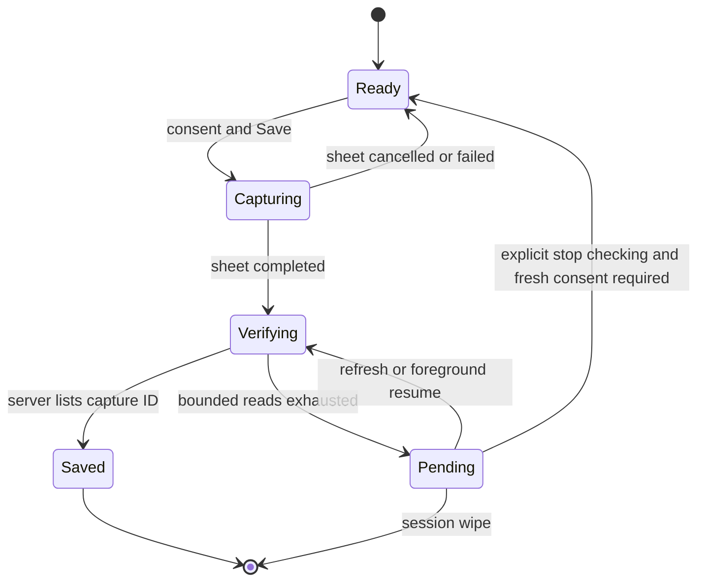

# Mobile functional repairs

Story: US-mobile-functional-20261028.

Status: finalized following two independent challenge rechecks and the 2026-10-28 design-review mechanism ruling.
Decided by: the design review, 2026-10-28.
Date: 2026-10-28.
Scope: customer saved-card capture and pending recovery on Android/iOS; partner invoice PDF readiness and diagnosis; customer iOS Live Activity registration, recovery and APNs environment routing.

## Boundaries

- Preserve amounts, card consent, charging behavior, cancellation rules, invoice ownership, tenant filtering and all logout/revocation/GDPR token retirement.
- No PRO access, local az, ignored signing/config inputs, database reset, environment change, deployment, merge or store upload. Light DEV evidence is read-only and limited to the reported failures; no card save or order transition is initiated to manufacture evidence.
- No promise of immediate APNs delivery. Distinguish request acceptance, device delivery and local rendering.
- Do not alter the shared outbox/queue timing or its existing at-most-once dispatch semantics in this repair. Their timing is measurable source behavior, but no runtime evidence yet isolates them as the user's avoidable delay.
- No invoice regeneration/upload/backfill on shared DEV. A discovered data repair is prepared and reported separately.

## Baseline ground truth

This table records the pre-change state at d9fd28854e1948f092dadf68a322794dcf60bdad. The implementation changes the reported defects; it does not preserve them as current-state claims.

Paths below are relative to `/Users/michael/cleansia-work.noindex/wt/cleansia`.

| Claim | Source |
| --- | --- |
| iOS creates a SetupIntent, presents Stripe PaymentSheet and reads the server card list eight times, 1.5 seconds apart after the initial read. Missing card becomes an information snackbar; the pending identity is cleared. | `src/cleansia_ios/CleansiaCustomer/Sources/Features/Payments/PaymentsViewModel.swift:117–180` |
| iOS foreground resume only refreshes after receivable Checkout, not after the card's pending timeout. | same file:76–82 |
| Android repository supports SetupIntent capture but Payments screen/ViewModel lack add-card consent, presentation and completion. | `src/cleansia_android/customer-app/src/main/java/cz/cleansia/customer/core/payments/SavedCardRepository.kt:27`; `src/cleansia_android/customer-app/src/main/java/cz/cleansia/customer/features/payments/PaymentsViewModel.kt`; `src/cleansia_android/customer-app/src/main/java/cz/cleansia/customer/features/payments/PaymentsScreen.kt` |
| Saved-card capture is confirmed by a Stripe webhook, not by a client assertion; setup captures no charge. | `src/Cleansia.Core.AppServices/Features/SavedCards/CreateSavedCardSetupIntent.cs:17`; `Features/Payments/HandlePaymentNotification.cs:196,540`; `src/Cleansia.Infra.Clients/Stripe/StripeClient.cs:512` |
| iOS invoice mapper loses the existing PDF address, and its open predicate only tests generation failure. Android always offers Open PDF. | `src/cleansia_ios/CleansiaPartner/Sources/Features/Earnings/InvoiceDetailViewModel.swift:36`; `src/cleansia_ios/CleansiaPartner/Sources/Data/PartnerPayrollModels.swift:77`; `src/cleansia_android/partner-app/src/main/java/cz/cleansia/partner/features/invoices/InvoiceDetailScreen.kt:178` |
| Invoice detail and download accept the same invoice identity; both enforce ownership. Download incorrectly treats an owned invoice with no PDF path as invoice.not_found. | `src/Cleansia.Core.AppServices/Features/EmployeePayroll/DownloadInvoice.cs:43–56`; `GetInvoiceById.cs:59–68` |
| Background invoice writing commits the row before PDF creation/upload; another GenerateInvoice command creates invoice rows without PDF creation. These are source paths, not proof of the screenshot's runtime cause. | `src/Cleansia.Core.AppServices/Services/PayPeriodBackgroundService.cs:438–467`; `Features/EmployeePayroll/GenerateInvoice.cs`; `src/Cleansia.Functions.Core/Handlers/GenerateInvoiceHandler.cs:60` |
| DEV selects APNs sandbox from API environment, irrespective of signing entitlement. | `deploy/bicep/main.bicep:644`; `src/Cleansia.Infra.Clients/Apns/ApnsLiveActivityClient.cs:126` |
| Existing APNs BadDeviceToken/410 classification prunes tokens; send priority is already 10. | same client:103–108,136 |
| LiveActivityToken is already the per-device/order operational addressing entity. Its raw Token column is varchar(512); (UserId, DeviceId, OrderId) is the upsert key. | `src/Cleansia.Core.Domain/LiveActivities/LiveActivityToken.cs`; `src/Cleansia.Infra.Database/EntityConfigurations/LiveActivityTokenConfiguration.cs:19–29` |
| Local start occurs on an order-detail fetch for OnTheWay/InProgress. Server remote start occurs at OnTheWay. Registering a token currently drops registration failure. | iOS `Features/Orders/OrderDetailViewModel.swift:236`; `LiveActivity/CustomerLiveActivityRegistrar.swift:53`; backend `Features/Orders/NotifyOnTheWay.cs:132` |
| Foreground detail refresh is 30 seconds; outbox trigger 10 seconds; queue idle polling maximum 30 seconds. These do not prove a fixed sum of 70 seconds: dispatch paths/host warm state overlap and differ. | iOS `OrderDetailViewModel.swift:88`; `src/Cleansia.Functions/Functions/OutboxDrainerFunction.cs:14`; `src/Cleansia.Functions/host.json:25` |

## Saved-card acceptance criteria

SC1. Both platforms offer the existing native Stripe setup flow from Payments under the same market/build availability rules and explicit consent. Existing usable-card policy remains unchanged. A tap visibly enters submitting state and ignores duplicate taps.

SC2. PaymentSheet cancel/failure returns to a usable screen, clears the in-flight capture, preserves saved cards and makes no claim that a card was saved. Setup/API failure is actionable through existing error conventions.

SC3. Sheet completion means verification pending until GetMine contains the returned savedCardId. Show a persistent inline pending state, explain verification and provide Refresh/Retry verification. Preserve that pending identity in session-scoped state through screen refresh, leaving/reentering Payments and ordinary foreground/background transitions. Key pending capture by authenticated session/user and the capture market/currency; switching market must not present or verify it as another market's card. Use the existing session-wipe registry/repository contract: logout, revocation, account switch and session wipe cancel verification and erase pending state before another user can observe it. Do not mint another SetupIntent while one is pending, except after the explicit restart in SC5.

SC4. Keep the existing bounded immediate polling budget; do not poll indefinitely. A bounded refresh on resume, explicit Refresh, or later load can complete the pending capture. Clear consent only after confirmed success; card replacement/usable-card semantics continue to come from the server.

SC5. If explicit verification fails, retain the pending state and surface the failure. If the network works but the card remains absent, retain an honest pending state. Provide an explicit way to stop verification and start a fresh capture, with a concise explanation that this stops checking and does not cancel the already completed Stripe setup: saving can still finish later. A restart clears consent and requires fresh consent. Bind any subsequent success only to the new returned savedCardId; an old callback cannot complete the new capture. Later server card lists remain authoritative, including the existing per-currency replacement/late-webhook behavior. Do not claim the previous setup was cancelled, changed on the server, or prevented from replacing a card. No new backend cancellation/confirmation endpoint is required without evidence that webhook processing itself is defective.

SC6. Tests cover screen leave/reentry, market switching, logout/account switch during polling, stale callback after restart, late old-card appearance without completing the new capture, duplicate tap, consent/availability gate, sheet cancellation/failure, immediate success, webhook delay beyond initial budget followed by resume/manual verification, verification failure, no false success and no unintended second capture. Android also pins the generated SetupIntent request and PaymentSheet setup-vs-payment intent configuration.

## Invoice acceptance criteria

IN1. Reuse existing DTO fields PdfBlobName and PdfGenerationFailed. Both mobile apps distinguish: ready (nonblank PDF path, including a previous readable document after failed regeneration), unavailable/pending (no path and no failure), failed (no path and generation failure). Offer Open for a nonblank path; if regeneration failed while a previous PDF survives, retain the failure/stale-document warning and access to that document. No-path states explain the state and offer refresh rather than a dead Open button. Do not expose the blob path or raw internal invoice ID in the UI.

IN2. A download still enforces the existing invoice ownership/tenant gate before revealing readiness. Foreign/nonexistent invoice remains invoice.not_found. An owned invoice with no path receives a distinct PDF-not-ready business result (or existing generation-failed result when the failure flag is set). Never relabel this as an absent invoice.

IN3. Preserve both supported stored path forms (absolute generated-invoices URL and container-relative blob name) and their current URI unescaping. An owned invoice with a stale/missing blob receives an honest PDF-unavailable outcome, without weakening the ACL or swallowing unrelated storage/network failures. Use existing blob abstractions and a narrow existence/read classification; no provider exception type in Core.

IN4. Before final completion, trace the screenshot case using permitted existing read-only DEV evidence: identify the invoice via its display number, verify row readiness flags/path presence without printing path/PII, and verify blob existence if the authorized existing evidence tool permits it. Record exactly what was observed and whether it distinguishes a seed artifact, writer path, pending generation, generation failure or missing object. If existing access cannot establish it, say runtime cause unverified; do not claim that hiding the button fixed generation.

IN5. Fix a deterministic writer/path defect only after evidence links it to the report and the agreed scope. Shared DEV repair remains unexecuted. Tests cover owner vs foreign access, no path, failed generation, stored path variants, ready PDF and missing storage object. Client tests cover all readiness states and refresh into ready.

## Live Activity decision and alternatives

### Primary evidence

- Apple identifies BadDeviceToken as an invalid token, including a token/environment mismatch, and instructs: “Don’t retry notification responses with the error code BadDeviceToken”. It warns frequent invalid-token errors can accelerate connection termination. [Handling notification responses from APNs](https://developer.apple.com/documentation/usernotifications/handling-notification-responses-from-apns?language=_4).
- Apple documents separate APNs endpoints and token-based HTTP/2 delivery. [Sending notification requests to APNs](https://developer.apple.com/documentation/usernotifications/sending-notification-requests-to-apns).
- ActivityKit push updates use priority 10 for prompt high-priority delivery; OS policy still governs delivery. [Starting and updating Live Activities with ActivityKit push notifications](https://developer.apple.com/documentation/activitykit/starting-and-updating-live-activities-with-activitykit-push-notifications).

### Alternatives

A. Flip DEV's global APNS UseSandbox to production. Rejected: fixes TestFlight while breaking Xcode sandbox builds; API host environment does not determine signing environment.

B. After explicit DEV BadDeviceToken, try the other APNs endpoint once. Rejected in this draft: a definitive first rejection prevents duplicate accepted sends, but this is still retrying a documented nonretryable error and continually guesses the route on every send. No documented Apple exception was found. It can mask malformed tokens/configuration and extra bad-token traffic is avoidable.

C. Add optional environment metadata on registration and persist a versioned envelope in the existing Token varchar(512), with legacy raw fallback. Viable no-schema alternative, but not selected initially: it changes an existing raw-token field's meaning, reduces its available raw-token length, requires format/version validation and parsing across storage/dispatch, and makes operational diagnostics more complex. Device identity must never be repurposed because logout/shared-device retirement joins on it. This alternative is defensible only if the design review accepts those costs over a schema change; it must never silently send the envelope to APNs or prune it merely because one endpoint was guessed wrong.

D. Add nullable per-token `UseSandbox` metadata to LiveActivityToken and optional `UseSandbox` on the authenticated registration command; preserve raw Token and all keys. **Accepted choice following the design-review ruling and challenge closure**. New clients explicitly identify the supported signing configuration. The dispatch consumer passes the row's override to the APNs adapter; null legacy values use the existing global setting. No token guessing and no failed-send fallback. The client cannot select arbitrary hosts: it chooses only between the two fixed Apple endpoints; ownership, tenant, token retirement and APNs topic remain server-controlled.

**Database consequence of D:** this is a source schema change. Repository policy requires regenerating Initial and local integration verification; the next DEV deployment would require an explicitly approved DEV reset/reseed. No reset or deployment is authorized or executed now. Call out that future requirement before rollout. The clean column is not justified merely by a preference for cleanliness: it avoids a novel storage protocol and preserves the already public raw-token contract and varchar limit. Challenge passes must weigh this against the real future DEV reset cost before accepting D.

### Live Activity acceptance criteria

LA1. New registration carries optional explicit environment metadata. Old clients/old null rows continue using global APNS UseSandbox. Upsert refreshes environment with the current token without changing UserId/DeviceId/OrderId uniqueness or tenant stamping. Registration ownership, statuses and active-session protections remain unchanged.

LA2. Supported customer Debug Xcode sandbox and Release TestFlight production builds supply matching environment metadata even while both use DEV APIs. Source it from public build configuration wired consistently to signing configuration; do not use private SecTask APIs or infer from API URL/receipt path. Release artifact verification compares the app's environment marker with actual signed aps-environment. Ambiguous/nonstandard signing configurations require explicit build setting alignment and fail verification rather than silently claiming support.

LA3. APNs adapter routes once to the selected fixed endpoint; preserve priority 10, topic, inert/keyless behavior, cancellation and existing retry taxonomy. BadDeviceToken/410 stays terminal; no alternate-endpoint retry. Tests cover explicit sandbox, explicit production, legacy config fallback and one accepted send at most.

LA4. For transport failure or HTTP 5xx, registration makes at most three attempts per cycle: immediate, then after 2 seconds, then after a further 4 seconds. After exhaustion, retain only the latest unregistered token per push-to-start or order scope; an authenticated foreground resume can start a fresh bounded cycle. Coalesce concurrent resume/token emissions so at most one cycle exists per scope, cancel an older-token cycle on rotation, and recheck latest-token/session generation after every suspension and before recording success. HTTP 429 is retained for a later cycle with at least a 30-second local cooldown (the existing error contract does not expose Retry-After); do not immediate-retry it. Other HTTP 4xx auth/ownership/status failures stop and are not queued for automatic resume retry until a new session/token supplies a reason to try. Cancellation stops rather than retries. Session wipe cancels and erases both current/pending tokens before another user can observe them. Never log raw tokens, credentials or payloads.

LA5. Recover an absent local activity while the authenticated app is foreground using existing active-order data/refresh mechanisms (not only opening detail), for non-guest OnTheWay/InProgress orders. Do not start for New/Confirmed, terminal orders, disabled ActivityKit or the user's dismissed activity within its tracked lifecycle. Track user-dismissal suppression by authenticated session and order, including locally started and server-adopted activities, so subsequent Home/detail refresh does not recreate the dismissed card. Retire that suppression on terminal order state or session wipe/logout; never carry it to a new user. Existing activity identity adoption prevents duplicates and terminal status ends/retires activity as today. iOS 16.2 local support and 17.2 remote-start support remain distinct.

LA6. Apply newly received order status to the local activity without an added timer. Use existing push/order-refresh events and foreground refresh, before contemplating a shorter perpetual poll. Do not globally shorten shared outbox/queue intervals without runtime latency evidence and an explicit scoped amendment.

LA7. Tests cover transient registration recovery, permanent refusal, session cancellation/logout, token rotation, resume replay, server-restored adoption, duplicate avoidance, foreground recovery eligibility and terminal cleanup. Backend tests pin ownership/tenancy and lifecycle retirement with the new metadata. Report device-delivery verification separately; mock acceptance is not physical-device delivery proof.

## Verification and documentation

- Native focused unit tests for changed state logic and mocked payment presentation; visual checks of pending/error/readiness states on both platforms.
- Backend focused tests first; if D is accepted, regenerate Initial normally and prove model/schema agreement with the local real-Postgres integration suite. Never manually edit Initial. Preserve existing full token cleanup tests.
- Regenerate mobile OpenAPI clients/specs for a changed registration contract, using existing generation commands and committing generated tracked artifacts together.
- Add a superseding/companion decision for the accepted APNs routing mechanism; do not modify accepted ADR-0029 in place. Update push-notification docs and any rollout DB requirement while implementation proceeds.
- No functional area is declared complete solely from a cosmetic state change; report actual runtime evidence and remaining verification constraints.

## Challenge

- F1: Pending card persistence is undefined for Payments route reentry, market switching and session wipe.
- F2: Stopping verification cannot cancel a completed Stripe setup, and late webhooks can still replace the currency card.
- F3: Invoice source paths and ownership line references need correction.
- F4: Clean nullable environment metadata is preferable to an encoded raw Token, conditional on explicit future reset disclosure.
- F5: Foreground activity recovery can resurrect user-dismissed cards without scoped dismissal suppression.
- F2-A: A nullable environment column conflicts with a stricter interpretation that this scope forbids any source schema change, even without reset execution.
- F2-B: Registration retry/resume policy lacks an observable budget and duplicate/rotation semantics.
- F2-C: A late old setup must not complete a restarted card capture in the UI.
- F2-D: Hiding an unavailable invoice Open button alone does not establish that the PDF failure was repaired.
- F6: Failed regeneration preserves the previous readable PDF; a blanket failed-flag Open prohibition would remove valid access.

## Defense

- F1 — Concede and revise: SC3/SC6 now require session-scoped pending state across route reentry, market/currency isolation, all existing wipe triggers and stale in-flight cancellation. No user identity is read from a client-supplied body.
- F2/F2-C — Concede and revise: SC5 explicitly distinguishes stopping verification from cancelling Stripe setup, requires fresh consent, binds callback success to the current capture ID and keeps late webhook/server list behavior authoritative. It does not add a backend cancellation mechanism or claim to prevent existing server replacement.
- F3 — Concede and revise: invoice paths now point to Features/Earnings and Data/PartnerPayrollModels; GetInvoiceById ownership is 59–68.
- F4 — Conditional acceptance: D preserves the raw token field, limit, upsert key and retirement joins; the future reset cost is explicitly stated before adoption. The verdict must weigh that cost against C rather than treating source migration as free.
- F5 — Concede and revise: LA5 now requires session/order-scoped dismissal suppression for local and adopted cards, removed on terminal/wipe and never shared across users.
- F2-A — Scope interpretation rebutted, mechanism not yet adjudicated: reset execution and source migration are distinct. The current coordination instruction explicitly allows evaluating a clean field and says that a reset is not necessarily prohibited as a future requirement; this draft forbids reset execution now and prominently records the future prerequisite. Nevertheless, the mechanism remains proposed until the design review decides whether its operational cost is proportional; this response does not accept D by itself.
- F2-B — Concede and revise: LA4 now specifies three attempts with 2/4-second pauses, latest-token/session guards, per-scope coalescing/cancellation, permanent refusal handling and a separate 429 cooldown without a retry storm.
- F6 — Concede and revise: RegenerateInvoicePdf:161–172 refuses an empty replacement; its failure path stamps the error without clearing the previous PdfBlobUrl. RegenerateInvoicePdfFailureRecordingTests starts with a healthy previous PDF. IN1 now preserves Open for a previous path alongside a failure warning, and a backend test pins access to it.
- F2-D — Concede and confirm: IN4/IN5 require the source/runtime trace and explicit unverified reporting if read-only evidence cannot establish the case. Source or writer repair requires evidence; a hidden Open control is only the UI readiness fix.

## Verdict

Decided by: the design review, 2026-10-28. D is selected: typed nullable per-token environment metadata preserves the raw addressing token, its varchar(512) limit, existing key/tenant/lifecycle contracts and Apple's nonretryable-token rule. Its narrowly required source migration is within functional scope; execution of any DEV reset, deployment or environment change remains unauthorized. The future Initial-regeneration/reset prerequisite must be disclosed before rollout. The opaque-token envelope and BadDeviceToken host probing are rejected.

Both independent rechecks resolved all concrete challenges after the defenses above; no blocking technical objection remains. F2-A's scope question is resolved by the lead interpretation, not a claim that the user selected the mechanism. Invoice runtime cause remains an investigation outcome, not an assumed fact.

### Implementation order and ownership

1. Backend contract/schema work: optional `UseSandbox` on registration and the token entity; preserve every existing identity/cleanup/ownership gate. Add focused tests before logic. Apply the recipient override at the APNs adapter using only fixed Apple hosts. Add owned-invoice PDF readiness result and storage availability handling with focused ACL/path tests. Do not perform shared DEV repair.
2. Run backend contract generation via the existing scripts, then regenerate both mobile clients before dependent iOS wiring. Regenerate Initial normally under the dotnet lock and verify locally; record its new identifier and future DEV reset prerequisite. No manual migration editing.
3. Native functional implementation owns only Payments save-card state/presentation, invoice readiness/download binding and customer Live Activity registration/recovery/build marker. Presentation work owns unrelated UI files. Serialize per-app localization and generated clients; no file-wide overwrite of concurrent edits.
4. Update accepted-mechanism documentation with a new/superseding record and living push documentation. Keep prior accepted ADRs unchanged. Re-open source references against final code before close-out.
5. Focused native/backend tests, required checks and visual/device evidence are reported distinctly. Ask before merge; deployment/upload/reset need their own authorization.

## Flow

The pending record belongs to its authenticated session and capture market/currency. Stopping verification does not cancel a completed Stripe setup. Invoice financial creation and document readiness are separate facts: the shared manual/queue creation command commits the invoice before invoking the existing PDF command in a fresh per-invoice scope bound to its persisted tenant. A failed document commit discards that scope before another currency renders; cancellation stops remaining document work. A failed render records failure while the invoice remains created; the previous readable PDF, when present, remains accessible. The PDF command explicitly loads PayPeriod, which the renderer and blob path require. Existing admin regeneration is the recovery action for a rare crash after financial commit; this change adds no new dispatch protocol.

Initial was regenerated normally from `20261027013728_Initial` to `20261028213040_Initial`. Structural comparison shows only the nullable `LiveActivityTokens.UseSandbox` column, with no seed drift. This is a future rollout prerequisite, not approval or execution of a DEV reset.

Current backend implementation pointers: `src/Cleansia.Core.AppServices/Features/EmployeePayroll/GenerateInvoice.cs`, `RegenerateInvoicePdf.cs`, `DownloadInvoice.cs`; `src/Cleansia.Core.AppServices/Features/LiveActivities/RegisterLiveActivityToken.cs`; `src/Cleansia.Infra.Clients/Apns/ApnsLiveActivityClient.cs`. APNs routing is governed by [ADR-0078](../../docs/decisions/adr-0078.md).

Current iOS implementation pointers: `Sources/LiveActivity/LiveActivityRegistrationQueue.swift`, `CustomerLiveActivityRecovery.swift`, `CustomerLiveActivityRegistrar.swift`, `OrderLiveActivitySyncing.swift`, and `Sources/LiveActivityShared/LiveActivityCoordinator.swift` under the customer app. Recovery filters eligibility before its 20-detail-read budget and limits terminal cleanup to tracked cards. The exported-IPA guard in `src/cleansia_ios/scripts/check-live-activity-environment.py` runs before future customer uploads. No archive or upload is part of this work. Tracked-session dismissal suppression is in-memory; persistence after process death remains unverified. The existing background number resolver's recent-page assumption remains a residual.
