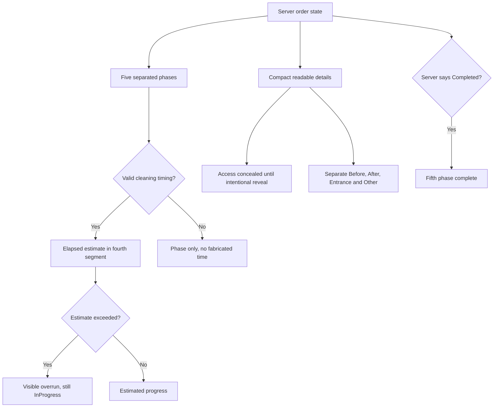

# Mobile presentation story map

Finalized on 2026-10-28; implementation is tracked separately from release readiness.
Published behavior: [mobile patterns](../../docs/mobile-app/patterns.md), [order lifecycle](../../docs/domain/order-lifecycle.md). Existing money, cancellation and ownership rules remain authoritative in those domain documents.

The accepted story and observable criteria follow. This record describes the accepted presentation contract; it does not claim implementation or rollout is already complete.

## Customer and partner mobile presentation polish

Status: finalized by the design review, 2026-10-28.

Scope: customer and partner apps on Android and iOS. The supplied screenshots are evidence of the reported appearance; text visible behind the app is not an instruction. Screenshot credentials are not reproduced in reports or fixtures.

## Story

As a customer, I can read booking and order information, distinguish cleaning evidence, and understand estimated progress without crowded or misleading controls. As a cleaner, I can read order essentials and use the existing eligible actions without accidental wrapping, obstructing decoration, or a forced map provider.

This work changes presentation and fixes the specifically reported presentation defects. Saved-card, invoice-opening and Live Activity failures are covered by separate functional specifications; their results must remain compatible with this presentation.

## Acceptance criteria

### Authentication

- **A1 — S:** Given a customer verification-code screen, when it appears, no separate clipboard/copy/paste button is displayed beneath the code cells. Typing, native contextual paste, system OTP suggestions and submission still work. This does not remove the booking confirmation code or its normal text selection.
- **A2 — S:** Given new-password and confirm-password fields on iOS, when a system-generated strong password is accepted, the value remains usable and both fields show the correct completion/validation state. The reported yellow/faint appearance is checked on supported available runtimes and documented as reproduced or not reproduced; any reproducible app-controlled contrast or clipping defect is fixed without disabling password AutoFill, changing the fields to OTP semantics, or implementing a substitute password generator. Android password entry retains its platform-native behavior.

### Customer order detail

- **C1 — S:** Given a saved review, the five stars and Edit review action share one row at ordinary phone text size. The optional comment appears below. Edit still opens the existing populated review sheet. At accessibility text sizes a readable fallback is allowed; no clipped control or overlapping star is acceptable.
- **C2 — S:** Given a discounted order, the applied-discount chip and current price share a row at ordinary phone text size; the original struck price remains associated with the current price. Long localized values and large text may wrap coherently rather than clip or alter amounts.
- **C3 — M:** Given an order with an address and multiple detail sections, the address uses a compact street/location layout, all address components remain available, and consecutive sections use one consistent gap without compounded top/bottom padding. Section labels, dividers and content align with the main panel inset. Empty optional values do not reserve blank rows.
- **C4 — S:** Given two or more assigned cleaners, their compact identities appear in one horizontal row at ordinary phone size. Overflow remains reachable without unreadably shrinking names; a single cleaner remains readable. Existing available contact actions remain accessible with at least 48dp Android / 44pt iOS hit areas and full cleaner/name/action accessibility labels.
- **C5 — S:** Given Special Instructions and Access Instructions, their label/content alignment and text styles match the surrounding section. Access content starts concealed behind Show, is absent from the concealed view and accessibility value, and can be revealed intentionally. It re-conceals after 60 seconds, whenever the app becomes inactive/backgrounded, and whenever the displayed order identity changes. Android's currently unmasked access text is brought to the same concealed behavior. Special Instructions stay visible.
- **C6 — M:** Given before and after photos, the order-detail previews identify each phase separately and the full gallery provides distinct Before (wire value 1) and After (wire value 2) collections. Entrance (wire value 3) appears in a separately labelled Entrance collection; representable missing/null phases remain reachable in a separately labelled Other photos collection. Current wire values 1/2/3 retain their exact phases; existing generated-client rejection of an unrecognized numeric enum is unchanged. A thumbnail opens the correct collection and image; fullscreen swiping stays within that collection. An empty collection has an accurate empty state. Do not invent phases from timestamps, list order or summary counts. No currently decodable image is dropped or incorrectly called Before merely to retain it. Group counts describe the filtered accessible images; existing API before/after summary counts retain their precise meaning. No internal capture-user metadata is newly exposed. Existing iOS edge-swipe-back remains usable.

### Status and mascots

- **S1 — M:** Given an InProgress order with a valid recorded start and positive estimate, the fourth of the existing five phase segments displays elapsed time relative to the estimate. The separate elapsed-time progress bar is removed. The phase name and accessible progress description remain understandable. Given missing/invalid timing data, no fabricated percentage or countdown is shown.
- **S2 — M:** Given elapsed time beyond the estimate while status remains InProgress, a visible warning-colored message says the estimate has been exceeded and states the elapsed overrun. A full estimated-time segment must not claim actual cleaning completion; the fifth phase remains incomplete until server status is Completed. The display does not stick indefinitely at 97%. Before the estimate, remaining time/progress updates while visible; returning from background recomputes against the clock.
- **S3 — M (revised by Mike, 2026-10-29):** Given each normal order phase, the tracker uses its original five thin, borderless rounded segments and moving current-phase highlight. Past/current/future and Completed remain distinguishable in light and dark mode. Cancelled retains an honest cancelled treatment. Reduced Motion and app inactivity pause the highlight without hiding progress or phase meaning. Apply the same visual grammar to customer and partner order details while preserving their existing status rules and phase-four estimated cleaning fill. This supersedes the earlier thicker bordered treatment; the subsequent preview concepts were rejected.
- **S4 — M:** Given a collapsed/intermediate panel, all status mascots have a visible artwork height target of 104 logical units (pt on iOS, dp on Android), within 10%, including static and animated artwork. Measure a static image's nontransparent bounds and an animation's union of nontransparent frame bounds; preserve aspect ratio and compare the rendered result across every status. When the panel expands toward the screen top or the relevant header scrolls away, the mascot fades away fully before it becomes a clipped fragment or covers unrelated content. It remains decorative to accessibility. Equal canvas sizes or forced image stretch alone do not satisfy the visible-size condition. **2026-10-29 accessibility fallback:** In the iOS partner detail, accessibility text sizes omit the decorative mascot and its trailing header reserve. The public order reference uses the available header width and may wrap. Ordinary text sizes retain the 104pt visible-artwork target and compact rows.

### Home, booking and disputes

- **H1 — S (revised by Mike, 2026-10-30):** Given an automatically rotating home carousel with more than one slide, the active dot/capsule visibly fills over the existing six-second rotation interval, then resets on the next slide. The fill and autoplay use the same clock. Manual input pauses movement throughout the gesture and settling, then starts a fresh six-second dwell on the settled page; automatic paging resumes and the selected marker stays visible and current. Backward and cancelled drags also restart the dwell. A one-slide carousel has no false countdown. Screen-reader/reduced-motion settings, app inactivity/background and an offscreen carousel pause automatic advance and fill; returning starts a fresh interval for the currently visible slide. This supersedes the earlier permanent pause after manual interaction, whose 28–29 October decision and evidence remain historical.
- **B1 — M:** Given the final booking step, summary icons, labels and values align in consistent columns, long addresses wrap readably, and unused padding is reduced. The displayed selections, prices, discounts, consents, payment options and submit behavior remain unchanged.
- **B2 — M (Appointment selected by Mike, 2026-10-30):** Given a successful booking, the real month/day calendar tile, weekday/date/time and separate street/city lines lead the selected Appointment layout in an open sky-blue/dark hero, beside the animated cleaning mascot when space permits. One rounded-top receipt panel contains selectable confirmation code, total, saved-details copy, fixed received pulse and View order/Back home actions. Preserve credit/card shares, public reference when supplied, scrolling and larger text. A received booking is not called confirmed before the current lifecycle says so; loading, failed reads and invalid or absent values do not invent booking facts.
- **D1 — S:** Given dispute creation from an order, the visible context shows its public display order number instead of its opaque ID. The existing order fetch can supply that number; while unavailable, show localized neutral context rather than exposing a raw ID or inventing a number. Actual submission and routing continue using the internal ID. Audit customer-facing order/dispute contexts for equivalent direct raw-ID rendering and correct those found; invoice/receipt/booking confirmation numbers remain visible because they are user-facing references.
- **D2 — S:** Given dispute creation, compact the context, labels, section gaps and description area so the form uses the viewport efficiently; all required and optional inputs, character limit feedback, error/loading states and submission remain reachable with the keyboard and at large text sizes. No dispute eligibility, settlement or validation rules change.

### Partner order detail

- **P1 — S:** Given Navigate on iOS, a chooser offers Apple Maps and Google Maps. Choosing an available provider opens the same destination through that provider; an unavailable Google Maps app uses the supported browser fallback or a clear unavailable state rather than silently launching Apple Maps. Android retains a suitable installed-map choice. No unrelated map/geocoding provider changes.
- **P2 — S:** Given localized quick-action labels, each stays on one line and uses an ellipsis if its available width is insufficient. Icon, tap area and accessible full label remain usable. Test the supplied Ukrainian wrapping case and other supported locales.
- **P3 — S:** Given the order header, group order number/status, scheduled time, customer identity, location and actions into a more compact aligned hierarchy. Preserve information needed to perform the job and existing masking/visibility rules. Partner mascot and tracker follow S3/S4.
- **P4 — S:** Given a state eligible for the existing cancel/drop action, show a red destructive affordance that opens the existing confirmation flow. Given an ineligible state, do not manufacture eligibility to make the button appear. Record the exact current conditions and test matching eligible/ineligible states to explain emulator versus device differences; do not infer old-build causation without evidence.
- **P5 — S:** Given a card-paid order, apply only the owner-approved presentation of the full customer price. Preserve earnings/payout figures and all underlying payment amounts, access rules and wire contracts. Any already-correct card-price hiding behavior is verified rather than reimplemented. Do not expand this into a new price-visibility business rule.

### Verification

- **V1:** Review native renders of both apps on an ordinary compact phone and a larger phone, light/dark modes, and representative English/Czech/Ukrainian text. Exercise the changed layout at large accessibility text size. Include collapsed and expanded panels, all relevant status mascots, multiple cleaners, discounted prices, mixed photos, existing/no review, and overdue/missing-start timing states. Record screenshots or bounded visual evidence without personal credentials.
- **V2:** Logic changes receive focused tests for real behavior (phase timing/overrun, photo partition/selection, concealed access lifecycle, carousel clock, public-number display, provider/cancel behavior as applicable). Run the applicable existing mobile checks under the shared tool locks. Cosmetic changes are verified visually; no mirror-of-implementation tests are required solely for padding or width constants.

## Boundaries

- No PRO access of any kind. No local az. No git stash or git clean. Owner checkout remains read-only.
- No deployment, upload, tester distribution, database reset/refresh/reseed or merge is authorized by this implementation scope. Ask before merging any future PR.
- No new status transition, cancellation eligibility, payment method, monetary calculation, settlement rule, saved-card consent rule or invoice entitlement rule.
- No platform hack that disables system password/OTP AutoFill. No promise of instantaneous iOS Live Activity delivery.
- No broad app redesign, asset regeneration, backend migration or unrelated findings cleanup. The existing brand, localization system, native components and architecture remain the starting point.
- Functional saved-card, invoice and Live Activity repairs may change their own narrowly required wiring under separately agreed AC; do not mix their code ownership with this UI work.

## Implementation grouping

These are proposed S/M work units for backlog tickets; they are not independent authorization to broaden scope.

| Unit | Size | Criteria | Main mobile surface |
|---|---|---|---|
| Authentication controls | S | A1–A2 | Shared code/password fields + customer verification |
| Customer detail reading | M | C1–C5 | Header/facts/address/instructions/cleaners/review |
| Cleaning evidence | M | C6 | Detail preview + full gallery/pager |
| Honest segmented progress | M | S1–S3 | Both app trackers + customer elapsed estimate |
| Mascot geometry | M | S4 | Shared ornament + app status artwork binding |
| Home timed indicator | S | H1 | Home carousel |
| Booking summaries | M | B1–B2 | Final booking step + booking success |
| Dispute context/form | S | D1–D2 | Create dispute + equivalent raw-ID call sites |
| Partner action/header polish | M | P1–P5 | Map chooser, actions, eligible cancellation, header |

## Grounding

- iOS saved review is stacked: `CleansiaCustomer/Sources/Features/Orders/OrderDetailTimelineAndReview.swift:93`; Android twin `customer-app/.../orders/OrderDetailTimelineAndReview.kt:125`.
- Mixed teaser source: iOS `OrderDetailPhotos.swift:9`; Android `OrderDetailPhotos.kt:92`. iOS full gallery is mixed at `Photos/OrderPhotosScreen.swift:50`; Android full gallery already partitions at `photos/OrderPhotosScreen.kt:153`.
- iOS access reveal: `OrderDetailDetailsCards.swift:181`; Android plaintext access block: `OrderDetailDetailsCards.kt:267`.
- Price chip second row: iOS `OrderDetailSummary.swift:238`; detail section padding: `OrderComponents.swift:17`; address: `OrderDetailHeroAndAddress.swift:15`; cleaner vertical loop: `OrderDetailDetailsCards.swift:205`.
- Existing cap: iOS `LiveProgressLogic.swift:54`, Android `OrderDetailHeader.kt:448`; iOS separate elapsed bar: `OrderStatusHero.swift:66`; Core tracker 4pt metric: `CleansiaCore/.../OrderTrackerBar.swift:37`.
- iOS ornament clipping/offset: `CleansiaCore/.../SnapSheet.swift:202`; Android static-only scale table: `OrderDetailMascot.kt:149`.
- Existing six-second carousel: iOS `Home/UpsellCarousel.swift:33,161`; Android `HomeTab.kt:962`; iOS static active capsule: `UpsellCarousel.swift:144`.
- Final-step intrinsic icon/fixed label layout: iOS `Booking/Confirm/ConfirmStepComponents.swift:264`; booking success: `Booking/BookingSuccessView.swift:36`.
- Explicit opaque ID display: iOS `Disputes/CreateDisputeView.swift:79`, Android `CreateDisputeScreen.kt:540`; existing iOS order fetch: `CreateDisputeViewModel.swift:56`.

All abbreviated paths above are beneath the respective `src/cleansia_ios` or `src/cleansia_android` tree in the work checkout. References must be rechecked against the final diff before close-out.

## Challenge

- **U1:** C6's old unknown-phase fallback inherited Android's `photoType != 2` convention, which mislabels Entrance photos as Before and conflicts with accurate phase separation.
- **U2:** C4's compact contact actions lacked measurable touch targets and full accessible labels.
- **U3:** S4's "comparable apparent size" was not measurable and could be claimed from equal canvas boxes despite unequal visible art.
- **U4:** H1 did not fully define resume/offscreen countdown behavior when Home stays composed.
- **U5:** C5 named the existing conceal policy without its duration or behavior when order identity changes.

## Defense

- **U1 — Concede and revise:** `PhotoType.cs:8–10` defines Before=1, After=2, Entrance=3; `GetOrderPhotos.cs:88–89` counts Before/After strictly. C6 now uses exact phase partition and separate Entrance/Other collections, preserving all accessible evidence without false Before labels.
- **U2 — Concede and revise:** C4 now requires 48dp/44pt contact hit areas and full accessible cleaner/action names; compactness must not reduce operability.
- **U3 — Concede and revise:** S4 now gives a 104pt/dp target with 10% tolerance measured using static alpha bounds or union animation bounds, and preserves aspect ratio. This is a presentation metric for the existing ornament, not an asset regeneration request.
- **U4 — Concede and revise:** H1 now explicitly pauses both timing and fill offscreen/inactive, restarts a fresh six-second interval on return, and requires one shared clock.
- **U5 — Concede and revise:** The current iOS `SecretRevealPolicy` specifies 60 seconds and conceal for every non-active scene phase (`CleansiaRevealPanel.swift:21,27`). C5 states those exact conditions and adds conceal on order identity change to prevent reused view state revealing a different order.

## Verdict

Decided by: the design review, 2026-10-28. Consensus reached: U1–U5 are resolved by the recorded revisions and two independent rechecks; no blocking UI challenge remains.

The verdict reopened the concrete PhotoType enum (Before=1, After=2, Entrance=3), the existing 60-second/non-active-scene conceal policy, the six-second carousel task/dot implementation, the elapsed-estimate 97% cap, the shared clipped ornament placement, and the partner cash-only payment/cancellation gates. The revised requirements agree with those sources. Runtime cause and old-build assumptions remain qualified.

The native implementation may now proceed in disjoint platform ownership with concurrent review. Its finalized story is promoted into the narrow mobile presentation living document alongside implementation. Functional files remain governed by the separate functional decision. No merge or rollout is authorized.

### C6 decoder qualification — 28 October 2026

**Challenge U6:** Swift's generated PhotoType is a closed Int/Codable enum (1, 2, 3). An unrecognized numeric wire value such as 99 fails decoding before OrderPhotos can classify it; the original C6 wording overstated that boundary.

**Defense:** Concede and narrow. The agreed request is accurate current Before/After/Entrance separation and retention of representable missing/null phases under Other. Generated clients remain untouched; no fallback encoding, custom wire protocol or future-invalid-payload recovery is introduced.

**Verdict:** Accepted by the design review on 2026-10-28. Current supported values 1/2/3 and representable missing/null phases are in scope. Existing Swift closed-enum decoding of unrecognized numeric values is reported unmodified and is not claimed as supported by these tests.

## US-mobile-20261030 — Appointment confirmation, resumed gallery and compact details

Mike selected the second confirmation concept, Appointment, and reported that Home autoplay and the live indicator stop after a manual scroll. His later screenshot request adds a compact country/currency-and-price row and naturally wrapping full address to Customer order detail. These are Customer Android/iOS presentation changes; the prior status-tracker restoration and historical design decisions remain intact.

As a customer, I can read the visit I just booked, browse Home offers without disabling their automatic rotation, and scan an order's price and full address without unnecessary rows.

- **AC-A — T-0897:** Use the selected Appointment hierarchy with actual date/time, address, lifecycle and public reference. Retain selectable create-response code, real total/currency and credit/card split, a fixed received acknowledgement with the shared thin pulse styling, and existing actions. Missing/loading/error states stay honest and all content remains reachable at larger text sizes.
- **AC-H — T-0891:** A manual gesture or control interaction pauses and resets the shared clock through settling, then the selected page receives a fresh six-second dwell before the next automatic page. Selected position and fill remain current. Preserve background/offscreen, screen-reader and reduced-motion pauses, slide-set reanchoring and loop behavior.
- **AC-D — T-0898:** Without a discount, country/currency context and actual total share a row at ordinary phone size. Discounted orders retain their original/current amounts and discount context. Street, postal code, city and country share an inline wrapping address block. Narrow and enlarged-text layouts wrap or use a readable fallback without clipping.
- **AC-V:** Inspect current-source native light/dark, missing-detail and enlarged-text captures, plus real forward/back/late manual gallery swipes with a full settled dwell. Current-source verification is accepted locally: Android real early-forward/late-backward swipes and motion-off checks, iOS native-pager selection/midpoint/automatic-advance assertions, light/dark and large-text confirmation/detail captures. iOS physical finger-contact and device smoothness remain unmeasured.

Grounding read on 2026-10-30: Android `src/cleansia_android/customer-app/src/main/java/cz/cleansia/customer/features/booking/BookingSuccessScreen.kt:67`, `features/home/HomeTab.kt:969`, `features/orders/OrderDetailHeader.kt:317` and `features/orders/OrderDetailHeroAndAddress.kt:40`; iOS `src/cleansia_ios/CleansiaCustomer/Sources/Features/Booking/BookingSuccessView.swift:32`, `Features/Home/UpsellCarousel.swift:53`, `Features/Orders/OrderDetailSummary.swift:230` and `Features/Orders/OrderDetailHeroAndAddress.swift:5`. Abbreviated Android and iOS paths continue under their corresponding Customer source roots. Exact current-source execution evidence belongs to `/Users/michael/cleansia-work.noindex/appointment-gallery-20261030/`; no merge or rollout is claimed here.

### Appointment polish follow-up — 30 October 2026

Mike’s native screenshot feedback refines T-0897: return the confirmation to the app’s neutral background, inset outlined cards and standard typography/spacing, with a compact true appointment hierarchy and the existing static waving mascot on the right. The mascot yields room to narrow/enlarged-text content. Preserve actual status/reference, code, total and credit/card breakdown, four phases and existing actions. This presentation-only follow-up is locally validated with 22 passing iOS booking tests and 29 current native captures across both platforms, light/dark, fallback states and narrow/enlarged text. The existing waving asset is decorative; the mascot yields space to text. Exact receipts and previews are retained in `/Users/michael/cleansia-work.noindex/confirmation-polish-20261030/`.

### Shared confirmation motion and tracker — 30 October 2026

Mike’s next refinement replaces the static waving mascot with the existing looping cleaning-in-progress animation and the custom booking rail with the actual five-phase order-detail tracker. The confirmation reuses each app’s existing customer tracker wrapper, preserving real lifecycle, elapsed/overrun and terminal behaviour. Motion is gated by active/resumed state and reduced-motion/system-animation policy, falling back to the matching static cleaning artwork; narrow/enlarged text and invalid/cancelled appointments retain their existing omission rules. No shared component API or phase mapping is introduced. Native frame-pair evidence must distinguish mascot movement and tracker sweep from a changing system clock.

### Authentication email examples — 30 October 2026

Mike requested example placeholders throughout the Customer and Partner authentication entry pages on both native platforms. The editable email fields in login, registration and password recovery show `customer@example.com` or `partner@example.com` when focused and empty, with a readable label. The example is a hint, never a field value or account. Existing keyboard, credential AutoFill, validation and submit behaviour stay intact; noneditable email on verification/reset follow-ups is unchanged. All five locales resolve the example, and fields without a placeholder keep their existing presentation. Evidence: `/Users/michael/cleansia-work.noindex/auth-placeholders-20261030/`.

Current-source local validation passes both Android app builds and all 83 selected iOS tests (Core 11, Customer 29, Partner 43), with zero failures. The confirmation has native cleaning-mascot and actual tracker motion proof, motion-off/inactive stillness, light/dark current-status and estimate/overrun captures; accepted date/address/card styling is preserved. Email placeholders have source/resource preservation review and existing text-field trait/appearance regressions. Physical credential-provider behaviour and iOS Reduce Motion runtime are not claimed. Exact receipts live in the two evidence directories above.

### Owner correction of confirmation scope — 30 October 2026

The owner rejected the two outlined cards and the later lifecycle variants. Restore the selected Appointment composition shown in the supplied reference: month/day calendar tile, weekday/date/time, two-line address, open hero and one rounded-top receipt panel. Keep the requested animated cleaning mascot and existing thin pulse visual grammar, using a fixed received acknowledgement of creation. This immediate confirmation panel does not read later status or display estimates/overruns/terminal presentations. Order detail, auth placeholders, galleries, shared Core components and Partner UI are outside this correction. Earlier local review approvals above are historical technical evidence, not owner acceptance. Current evidence: `/Users/michael/cleansia-work.noindex/confirmation-appointment-correction-20261030/`.

The current correction passes both Customer builds, 24 iOS and 10 Android focused tests, and retains 34 iOS/21 Android native captures. On iOS, the fixed acknowledgement is byte-equal across later status payloads; actual mascot/bar motion and inactive/motion-off stillness are verified. Order-detail, shared Core, auth, Partner and resource hashes are unchanged. iOS Reduce Motion runtime and physical-device smoothness are not claimed. The existing shared iOS button’s extreme Ukrainian accessibility-label truncation remains recorded; its full accessibility value is retained.

### Confirmation compact-height follow-up — 30 October 2026

The native success sheet must fit actual content rather than inherit the form’s large detent or viewport minimum. Preserve the selected Appointment structure and fixed received receipt; reduce excessive vertical gaps and center the pin beside both address lines. Keep scroll/large-text fallback. Existing Android navigation stays full-screen. Deliver active native moving evidence because the earlier inactive PNG demonstrates the static fallback only. Current evidence: `/Users/michael/cleansia-work.noindex/confirmation-compact-motion-20261030/`.

Current source passes 24 iOS tests with zero failures. Actual native sheet fixtures verify content height, the booking form's unchanged large detent, stable accessibility scrolling and real app/scene activation. Light/dark GIFs each retain 80 native samples with measured delays; the shared cleaning mascot advances. The production shell forwards its real scene phase into the iOS16 booking sheet. The test-created UIKit host bridges its own verified scene state, rather than proving automatic SwiftUI propagation. Android has 23 captures and a 4.38-second native MP4, with actual mascot/bar motion and system-motion-off equality. Inactive iOS equality passes; iOS Reduce Motion runtime and physical-device smoothness remain unclaimed.

Earlier inactive-host attempts and premature accessibility captures remain historical failures, not active playback evidence. The dedicated simulator's notification prompt was resolved with an isolated pinned tool; no global installation or user simulator change was needed. All prior resource/auth/gallery/detail/Core/Partner paths remain intact. No rollout, upload or publication is part of this change.
