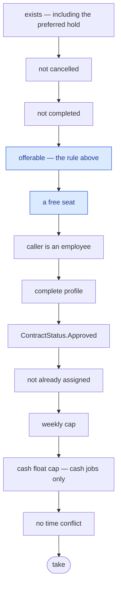

# Offerability

**Which orders a cleaner may be shown, and which they may take.** One rule, evaluated at two moments,
living in exactly one place: `OrderAvailability`. Every surface reads it; none re-derives it.

## The rule

It reads **seven order scalars plus the supplied current UTC instant**, returns a bool, and spans both axes of the
[order lifecycle](/domain/order-lifecycle):

```csharp
(CurrentStatus == New || CurrentStatus == Confirmed
    || CurrentStatus == OnTheWay || CurrentStatus == InProgress)      // the work is not over
&& (PaymentStatus == Paid
    || (PaymentType == Cash
        && (RecurringTemplateId == null || CustomerConfirmedAt != null))) // payment qualification
&& CleaningDateTime.AddMinutes(EstimatedTime) > nowUtc
```

The status term asks one thing — is the work over? — and qualifies nothing about money. The money term
carries the whole payment qualification. That split is [ADR-0057](/decisions/adr-0057) (owner ruling
2026-09-08): until then the status term read `Confirmed || (New && Cash)`, because the Stripe webhook
wrote `Confirmed` when a card payment settled. `Confirmed` now means only that a cleaner took the job,
so a paid card order rests at `New`, and the cash qualifier would have taken every card job off every
board.

**The slot must still be open** ([ADR-0076](/decisions/adr-0076), owner ruling 2026-10-13). A seat stops
being offered and takeable at its cleaning start plus raw booked estimated minutes; equality is ended.
Crew size does not shorten that slot. Started work with a free or covered seat remains offerable until
then, including 180- and 240-minute jobs more than two hours after start. The open board, dashboard
count and preview use this boundary instead of a two-hour start-date floor. Assigned cleaner, owning
customer and administrator access remain independent of it.

The unfilled-order sweep keeps its 30-minute late-fill grace and 168-hour lookback. A +10-minute
unfilled 60-minute slot can still be taken before the sweep gives up. At end the open seat disappears
even if the sweep has not run; a stale list's take is refused as `order.not_takeable` when expiry is the first failed check. Earlier opaque existence/hold/currency checks and terminal-status refusals keep their existing keys. The sweep does
not adopt offerability: its never-started, empty-crew and money selection still governs cancellation.

## Why a status list cannot express it

Every status the rule admits is also a status it refuses, depending on the money. What the money term
decides:

| Order | Offerable | Why |
|---|---|---|
| One-off, cash | **yes, from creation until slot end** | Nothing scheduled can retract it. The take *is* the confirmation, and the money changes hands at the door |
| One-off, card, `Paid` | **yes, before slot end** | The webhook's `Paid` write puts it on the board; the status stays `New` until a cleaner takes it |
| One-off, card, `Pending` or `Failed` | no | The money has not landed. A `Pending` checkout is cancelled by `CleanupStalePendingOrders` once it is more than an hour old (the sweep runs every 15 minutes and takes at most the 500 oldest a run, so a larger backlog spreads over the following runs). `Failed` is only ever written together with a cancellation — by that sweep, or by the webhook when Stripe expires or cancels the payment |
| Recurring occurrence, card, `Pending` | no | The payment has not landed, and `AutoCancelStaleRecurringOrders` withdraws an unpaid occurrence an hour before the slot. A cleaner should not be standing in a doorway when that happens |
| Recurring occurrence, cash, not confirmed | no | The customer has not confirmed it, and the same sweep withdraws it |
| Recurring occurrence, cash, confirmed | **yes, before slot end** | The customer's confirm stamps `CustomerConfirmedAt` — its own marker, since 2026-09-28 — and the occurrence stays `Pending` until the cleaner records the cash, like any cash order. Until then the confirm wrote `Paid` before any money moved |
| Recurring occurrence, card, `Paid` | **yes, before slot end** | The webhook's `Paid`, after the customer confirmed and paid |

The money term **refuses everything either retracting sweep can still reach** —
`CleanupStalePendingOrders` (card, `Pending`, not recurring) and `AutoCancelStaleRecurringOrders`
(recurring, `Pending`, and for cash not yet confirmed — `Order.AwaitsCustomerConfirmation`): an order is
offerable only when neither sweep's filter would match it. The `Pending` orders it admits are cash
orders neither sweep touches: a one-off cash booking, and a recurring cash occurrence the customer has
confirmed. A third scheduled
retractor must be refused there too, or the board offers orders that are about to disappear.

The status term says the work is **not over**, not that it has **not started** (owner ruling
2026-09-06). A job longer than two hours has several seats, and the first cleaner to tap *on my way*
writes an order-level `OnTheWay` while another seat is still empty. Only `Completed`, `Cancelled` and
the dead `Pending` are out.

`OfferableStatuses = { New, Confirmed, OnTheWay, InProgress }` is the status term on its own — **the
coarse floor, not the rule**. It is there because the clients cannot evaluate the money term (they
filter on none of the money columns) and because it is the index-served prefilter on
`Orders.CurrentStatus`. A read that asks *"may a cleaner be offered this?"* and uses it without the
money term offers orders the rule refuses; the reads that use it on purpose ask a different question —
whether the work is still owed.

## Two evaluation forms, on purpose

| Form | Used by |
|---|---|
| `IsOfferableSql(nowUtc)` | queries — `OrderSpecification`, the new-jobs digest sweep |
| `IsOfferable(..., nowUtc)` | the in-memory write gate in `TakeOrder` |

They are **not** one shared expression. SQL and C# disagree on null semantics, and compiling an
expression tree on a request path is banned here. Instead they are pinned against each other by an
equivalence test over real Postgres — never by review.

A cross-stack check also holds the eight client-side status literals — across TypeScript, Kotlin and
Swift — to the canonical C# list, so a client cannot quietly drift into offering something the server
will refuse.

## The take is gated, not just the list

Showing an order and letting someone take it are different questions, and the second one is a single
ordered `Cascade.Stop` chain in `TakeOrder.Validator`:



**The order matters and a second chain would break it.** FluentValidation's class-level default is
`Continue`, so a second chain would run regardless of this one's verdict — the cascade is the whole
mechanism.

Note where *cancelled* and *completed* sit: **before** offerability. A cancelled order with a free seat
should say the job is gone, not that it is full.

## The preferred-cleaner hold

A separate question, conjoined by the surfaces that need it. Until `Order.PreferredHoldUntilUtc`, the
order's **first seat** is offered to `Order.PreferredEmployeeId` alone.

`OrderVisibility.NotHeldFrom` opens it on any of five terms — no hold set, no preferred cleaner, the
deadline passed, *you* are the preferred cleaner, or somebody is already assigned.

> The hold is folded into `TakeOrder`'s **existence** check deliberately. A held order must be
> indistinguishable from a missing one, or the refusal itself leaks the fact that someone else was
> named. For the same reason `PreferredEmployeeId` never appears on a partner-facing DTO.

**A release ends the hold its beneficiary held.** A cleaner dropping a job ends their own live
reservation on it, and — since [ADR-0067](/decisions/adr-0067) — **an admin rejection ends a hold whose
beneficiary is the rejected cleaner**: an order returned to the board must be *on* the board, and a
live hold would hide the seat from every other cleaner for up to twelve hours on behalf of someone who
can no longer work. A hold naming a *different* cleaner on a multi-seat job is not the release's to
end. Nothing else about offerability moves on a walk-back: `New` and `Confirmed` are both in the
coarse floor and the rule reads no seats, so an order that was offerable at `Confirmed` with a free
seat is offerable at `New`; the offer window and the lapse sweep are status-blind and unchanged.

## The cleaner's currency {#cleaner-currency}

The second (order, cleaner) question, and the same type answers it. A cleaner is paid in the currency
of the country they work in (owner ruling 2026-09-12), and an order in any other currency would earn
them a pay row, then an invoice, in a currency their payout account does not hold. So
`OrderVisibility.PayableTo` — the order is in the cleaner's currency, or the cleaner is already on it —
is conjoined with the hold into `OpenTo`, which the board, the count, the browse gate and the take all
read; the pending-offer list conjoins `PayableTo` alone. A null resolved currency fails closed: an
empty board, never every board. The resolver itself never hands the predicate a guess: a work country
with no configured currency throws before the board is read (owner ruling 2026-09-12), so a cleaner is
never shown the platform default's orders because their country's row is missing. The take answers
`order.not_found`, exactly as for a held order, for the same reason. `AdminReassignOrder` does not
read `PayableTo` — it is the override — but it does refuse a cleaner who is not approved, does not
work in the order's market, or is busy at the time
([reassignment](/admin-app/order-management#order-reassignment)). An assignment made over the
currency rule stays visible to the cleaner it was made for.
→ [Business rules](/product/business-rules#cleaner-currency)

## The cash a cleaner holds {#cash-float-cap}

The third (order, cleaner) question, and the only one that reads the cleaner's money rather than the
order's. A cleaner who holds **strictly more** of the company's cash in a currency than the company's
float cap (`cash.float_cap`, none by default) is not offered cash jobs (owner ruling 2026-09-28,
decision 25). `OrderAccessService.CashJobsHiddenFromAsync` answers it from the cash ledger and the
setting, and `OrderSpecification.HideCashFromEmployeeId` keeps every cash job off the read unless the
cleaner is already on it. The board, its count, the dashboard count and preview, and the pending-offer
list judge it in the cleaner's currency. The take judges it in the order's, after the weekly cap and
before the time conflict. It refuses with **its own key**, `order.cash_float_cap_exceeded`, not
`order.not_found`: the reason is the cleaner's own state and discloses nothing about the order or
anyone else. Card jobs are never held back.

Nothing is cached. The setting and the ledger sum are read on every request, so the cash jobs come back on
the next read once a remittance, a write-off or an invoice's set-off brings the cleaner to the cap or
below. The board carries no flag of its own; the partner apps learn why from
`GET api/EmployeePayroll/GetCashHeld` (`floatCap`, `cashJobsHidden`, per currency).

**Not every surface reads it.**
- The new-jobs digest and the seat-open push do not, so a cleaner over the cap can be told about a
  cash job their board will not show.
- The order detail and the contract preview do not, so a cash job reached by a link or a stale list
  still opens, and its take is refused.
- A customer can name a cleaner over the cap as their preferred cleaner. On a cash order that hold
  keeps the job from every other cleaner while its beneficiary cannot see it.

→ [Business rules — the company's cash in a cleaner's hands](/product/business-rules#cash-held)

## Seat allocation

Passing the gate is not the end. The seat itself is arbitrated by a unique index on
`(OrderId, SeatOrdinal)` — the three in-memory capacity checks are unlocked reads, and two cleaners
tapping the same single-seat job both pass all three. The loser's insert is rejected at commit and
turned back into the ordinary "no available spots" refusal, so the two paths cannot disagree. Since the
fix plan of 2026-10-25 a take also stamps the order, so its commit compares the order's tokens and a
take decided on a status that has since moved — a drop's walk-back, a cancellation, a refund — is refused
the same way, and a drop locks the order's row before it reads the crew.
→ [Business rules — when a cleaner leaves](/product/business-rules#crew-lost)
