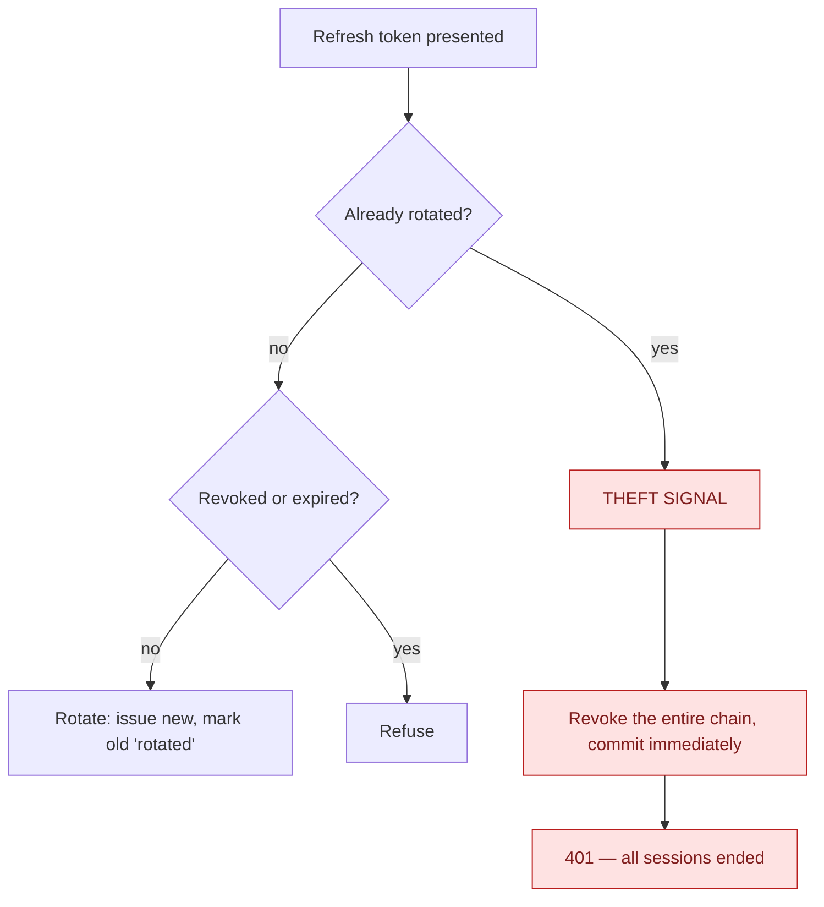

# Auth and identity

Sign-in, sessions, and how a stolen session is ended.

## Sessions

An access token is short-lived; a refresh token is the long-lived credential and is **rotated on every
use**. Only a hash of it is stored.

| Host | Access token |
|---|---|
| Admin web | 15 min |
| Partner web, Customer web | 30 min |
| Both mobile hosts | 30 min |

The web figures are deliberate: on web there is no device id, so the TTL *is* the revocation window.
Partner and customer web moved from 24 h to 30 min on 2026-09-28; both web clients refresh silently on
a `401` and replay the request, so a signed-in session outlives its access token. The customer site's
server render is always anonymous and never sees the token.
→ [ADR-0030](/decisions/adr-0030)

## Rotation detects theft

Presenting an already-rotated token means either a client that retried, or a thief. Both are handled
the same way: kill the chain.

**The chain revoke commits itself**, independently of the caller. The unit-of-work pipeline commits
only on success, and this path deliberately returns a failure — so without its own commit the security
revocation would be rolled back and every stolen token would stay valid.

Revocation is idempotent, so it retries on a concurrency collision rather than surfacing a 500. When
the retry budget is spent it falls back to a **set-based revoke that verifies termination** and throws
rather than reporting a revocation that provably did not complete. A kill switch cannot be outraced
into failing open.

One caller does **not** want that commit: the GDPR erasure, which must be one transaction, revokes
every session through a *staged* variant that rides the erasure's own single commit — a concurrency
collision there fails the erasure as a whole, which is the correct answer, and the retry is the
erasure's (→ [GDPR — erasure is one commit](/flows/gdpr-and-audit#erasure-is-anonymise-in-place)).

## Registration requires the tick, writes the consent, and the record of it

A customer sign-up **must** send `termsAccepted: true` — a missing or `false` tick is refused as
`consent.terms_not_accepted` before any account exists (owner ruling 2026-09-14; the refusal itself
is a row with the caller's IP). With the tick, the **server** grants `TermsOfService` and
`PrivacyPolicy` in the same commit as the account — each `UserConsents` row stamped with the
**document in force for the chosen market** (its version is its effective date, `2026-09-14` today,
and its id; [ADR-0063](/decisions/adr-0063)), the IP address and the device, read server-side and never
from the body. Nothing is parked in the browser or on the phone to be flushed later: the customer web,
the Android and the iOS customer apps all send the tick on the registration itself. An email
registration additionally leaves a `customer.account.register` audit row carrying the method, the
language, whether a referral code was given, the tick and both versions — with the new user's id,
which the session cannot supply because the user did not exist when the request began.

A Google or Apple **sign-up** grants the same two consent rows and writes no registration row — the
command is a sign-in-or-register, and its marker records the **sign-in** (below); on the provisioning
branch the handler declines the success row, and the consent rows are the proof. A social sign-up
without the tick is refused as `auth.social_account_not_found`: on the shared endpoint the tick is what
tells the sign-up screen from the sign-in screen, every client refuses client-side first, and the key
reads as "sign up first".

**The partner hosts register no customers** (owner ruling 2026-09-15, *"remove it"*). `POST
api/Auth/Register` is routed on the two customer hosts only — a cleaner's account is opened through
`RegisterEmployee` — and a Google sign-in on a partner host **signs in an existing cleaner or
administrator only**: a Google identity with no account is refused `auth.social_account_not_found`
and nothing is provisioned, a Customer-profile account is refused `auth.insufficient_privileges`
exactly as the password sign-in refuses it, and the e-mail confirmation on a partner host confirms an
Employee or Administrator only. Behind all three, `TokenService` refuses to mint a partner or admin
session for a profile that host does not serve — the command is expected to have refused first with
its own key, and the mint is the one seam every issuing command crosses. Until this ruling a first-time
Google sign-in on a partner host created a Customer and handed it a partner-audience token: an account
that could sign in where it had no business.

A customer granting a consent again later under a **different document** moves the consent row to it
and writes a `customer.consent.grant` row; withdrawing writes `customer.consent.withdraw`. The consent
row is the current state; those audit rows are the history. Since 2026-09-28 a newer terms or privacy
text is accepted before the next booking (`UserConsent.Covers`)
→ [Business rules](/product/business-rules#customer-record). On the partner hosts the same
`GrantConsent` command stamps no document, and a cleaner's registration records no customer consent
(`termsAccepted` stays on the wire, unread); a cleaner accepts their own versioned documents through
`AcceptLegalDocument` → [A cleaner's own documents](/product/business-rules#cleaner-documents).
Employee registration is not gated. → [ADR-0062](/decisions/adr-0062) D4 as amended

**Registering an unconfirmed address again with another password withdraws the stored one** (since the
fix plan of 2026-10-25, `Register` and `RegisterEmployee`): the account is left with no password, so of
two passwords typed for one address neither survives by default. The confirmer sets their own at
confirmation as described below. The same password again is kept until confirmation replaces it.
→ [Re-registration](/api/authentication#register)

**The registration and new-password fields offer the platform's strong password.** On the web, both
registration forms, the customer's reset step and the admin profile declare
`autocomplete="new-password"`; the customer profile's password change and the partner web's reset step
declare none. Since the fix plan of 2026-10-25 the Android and iOS apps declare their AutoFill types
too, so iCloud Keychain or Google Password Manager suggests one, saves it and fills it at sign-in; on
iOS the app's associated domain must be live on its web host
→ [Strong passwords](/mobile-app/overview#webcredentials). The suggestion meets the password rule: at
least 8 characters with a letter, of any alphabet, and a digit.

## The mailbox confirmer chooses the password {#confirmation-password}

The confirmation carries the password chosen by the mailbox holder (owner ruling 2026-10-26,
*"Close"*). Immediately after registration the web, Android and iOS reuse the password just typed,
held only in memory; on a later confirmation visit, including a sign-in detour, the screen asks for
one with the existing password rules and matching confirmation. Auto-submit waits for that form
to be valid. The code and chosen password reach the shared `ConfirmUserEmail` handler on all four
hosts, replacing the registration's hash before the first session is issued.

A legacy app or link request that sends no password still confirms and opens the session, but
leaves the account with **no password**. Forgot password sets one; an older registration password
never survives by default. Both the six-digit OTP and legacy-token branch follow this rule.
Source: `src/Cleansia.Core.AppServices/Features/Auth/ConfirmUserEmail.cs:179`,
`src/Cleansia.Core.Domain/Users/User.cs:409`.
→ [Security rule](/architecture/security-rules#confirmation-password)

Update before confirmation to avoid the legacy fallback. Once an old client has confirmed and the
hash is withdrawn, updating alone cannot restore it: Forgot password is needed before password login.
Installed builds do not acquire this screen from a server deploy. Android tester releases remain
deferred; the new TestFlight builds remain signing-blocked. Tell testers about the legacy reset
behavior until they run an updated client.

## The native customer apps need an account {#native-account-only}

A signed-out person who opens the Android or iOS customer app goes from the splash screen to sign-in,
and everything past it needs an account. Sign-in offers the password, *Forgot password*, Google (and
Apple on iOS) and *Register*, and nothing else. Since 2026-09-28 the customer mobile host takes an
order only from a signed-in customer, and since 2026-10-01 the apps no longer offer *Find a guest
booking* either (owner ruling, reversing the 2026-09-28 default that kept it). A guest booking is
made, tracked and cancelled on the web, from the link in its e-mail. What the apps still call
anonymously is what the sign-up form and the reads made with or without a session need. The mobile
host also still serves the six token-keyed guest routes, for app builds installed before the change,
until a follow-up removes them (T-0800).
→ [The anonymous allow-list](/mobile-app/api-integration#the-anonymous-allow-list),
[Guest order lookup](/flows/booking-and-pricing#guest-order-lookup)

## An Apple account's name {#apple-account-name}

Apple hands over the person's name once, on the first authorisation, and may send part of it or none:
the person can clear either part in Apple's sheet, and a later sign-in carries no name at all. The
server **never stores a blank part**. `UpdateCurrentUser` needs both names and `CreateOrder` a customer
name of at least two characters, so a blank part would leave the customer unable to save a profile or
book. A first Apple sign-in fills each part from the first of these that has one:

1. what Apple sent, trimmed. A whole name sent in one field is split at its first space, or at its last
   when it came as the family name;
2. the verified e-mail: its first name-shaped piece for the first name, its second for the last name
   (the local part split at `.`, `_`, `-` and `+`, letters only, at least two of them). An Apple relay
   address (`privaterelay.appleid.com`) is a random token and gives nothing;
3. the placeholder: `Cleansia` for the first name, `Customer` for the last.

A Google or password account stores exactly the name its client sent; the server makes up no name for
it.

**A later Apple sign-in that carries the name replaces only what the server wrote.** Per part, it
replaces a stored value that is blank or equal to what this account's e-mail gives (the piece, or the
placeholder word), and leaves every other value alone, so a saved name that differs from those is never
touched. A sign-in without a name changes nothing, except a blank part left by an older server, which it
fills the same way. Apple sends the name again only after the person revokes the app in their Apple ID
settings and signs in afresh.

**The profile says when the stored name is the placeholder** (owner ruling 2026-11-08).
`GET api/User/GetCurrent` on the customer and partner hosts, web and mobile, carries `isNamePlaceholder`.
It is `true` for an Apple account whose stored first name is `Cleansia` or whose stored last name is
`Customer`, compared trimmed and in any case, a blank part counting too. `true` means at least one stored
part is a word the server wrote, so a client treats the **whole** stored name as no name, a part the person
gave included. It is `false` for every Google and password account, whatever its name (*Test Customer*
included), and for an Apple account whose name carries neither word, one built from the e-mail included.
No Apple account can sign in on a partner host, so there it is always `false`.

| Apple sent | E-mail | Stored | `isNamePlaceholder` |
|---|---|---|---|
| no name | a relay address | Cleansia Customer | `true` |
| no name | `info@firma.cz` | Info Customer | `true`, for the whole name, so the onboarding never offers *Info* back as hers |
| no name | `jana.novakova@seznam.cz` | Jana Novakova | `false` |
| the given name only | a relay address | Jana Customer | `true` |
| the whole name | any | Jana Dvořáková | `false` |

It is computed from the stored row on every read and stored nowhere, so it follows the name with
nothing to keep in step. A save of a name that carries neither word, from the onboarding, Edit profile
or the web profile, ends it on every device at once. A save that replays the placeholder unchanged keeps it: the
session-start language update and a phone-only profile edit replay both names
(→ [The account's language](#account-language)). Apple's real name arriving at a later sign-in replaces
the placeholder parts and ends it too.

**Absent means `false`.** Only a server older than the member omits it, and `false` is how every app
read the name before the member existed: a non-blank name counts as given. A mobile mapper that reads
the member defaults it to `false` and never refuses the profile over it: a named exception to
[ADR-0048](/decisions/adr-0048)'s rule that a missing boolean is refused, which
[ADR-0081](/decisions/adr-0081) records for this member alone.

**What an app may do with it.** It exists for the customer apps' onboarding: given `true`, the
onboarding may open on its name step with both name fields empty and greet the customer without a name,
rather than *Welcome aboard, Cleansia!*. The iOS customer onboarding does exactly that; Android's has no
name step, because no account that signs in on Android can carry the flag. Nothing may gate on it: whether the onboarding shows at all,
booking and Edit profile, which keeps showing the stored name, do not read it. An app must not compare
a name with `Cleansia` or `Customer` itself; the rule lives on the server, so it can change without an
app release.

**Its limit.** Nothing stored tells a name built from the e-mail from one Apple sent, so a two-piece
guess reads as given: `jana.novakova@seznam.cz` stored as *Jana Novakova* is not reported, and a wrong
guess is corrected in Edit profile. The two placeholder words are evidence as well as a default: the
sign-in repair and this member recognise a placeholder by them, so changing either needs a data fix-up
of the rows already written. Why the member is computed rather than stored, and what a column would
cost → [ADR-0081](/decisions/adr-0081)

## The account's language {#account-language}

`User.PreferredLanguageCode` is the language the server writes in when it has no order to ask: the
sitewide promo push, every e-mail to a cleaner or an administrator, and a customer's e-mails that are
not about one order. A customer's e-mails about an order follow the language it was booked in
([the order records its language](/flows/booking-and-pricing#booking-language)).
It is a foreign key onto `Languages.Code`, so only a seeded code is accepted.

| How the account was opened | Stamped with |
|---|---|
| Password sign-up, customer or cleaner | the language the app or site is showing |
| Google or Apple sign-up | `en` — neither command carries a language |

All four apps keep it current afterwards, by one rule:

- **A change in the app's language picker** sends the language the app now resolves to.
- **The start of every session** — a sign-in, or a cold start into a kept session — reads what the
  server holds and re-states the language the user **chose** in the app if it differs. A user who
  follows the phone ("System") is never re-stated: the handset's language is not a choice, and it must
  not overwrite one made on another client.
- **The profile completion after a first sign-in** (the customer apps' onboarding form, shown at
  sign-in while the profile has no phone, until it is completed or skipped) sends the language the app
  resolves to, as the picker does: the language chosen in the app, or on "System" the first of the
  phone's languages the app supports, else English. It runs right after a Google or Apple sign-up,
  which the server stamped `en`, so it cannot send none on "System": that would leave a Czech phone on
  English e-mails and promo pushes until the customer touched the picker. It never sends the phone's
  language over a choice made in the app. Until 2026-10-01 Android did, because it sent the phone's own
  locale whatever the user had chosen.
- **Only the two names gate it.** The update replays the profile, because `UpdateCurrentUser` replaces
  first and last name outright, so it waits for both names — and, since 2026-10-01, for nothing else.
  The customer apps used to wait for a phone as well, which the server never needed: it validates a
  phone only when one is given and keeps the stored one when the field is blank, so a missing phone now
  goes as `""`. A customer who signed up with Google or Apple and never added a phone used to stay on
  `en` for good.

So a social sign-up is corrected when the customer completes the profile form after the first sign-in,
or the first time they pick a language in the app, and at every session start after a choice; one who
skips the form and never touches the picker keeps `en`. The session-start reconcile still re-states
only an explicit choice: it runs on every session, and on "System" it would overwrite a choice made on
another client each time. Sending the language with the Google or Apple sign-up itself needs a new
field on those two commands, which the owner left out of the 2026-10-01 change (client-only).

::: info A phone-less customer's profile edit now saves
Both customer apps send a missing phone as `""` on every profile save, not only on the language
update. A `null` used to be dropped from the body, and the binder refuses a command without its
non-nullable `PhoneNumber`, so a customer with no phone could not save a profile edit at all. Now the
edit saves and the stored phone, if any, is kept.
:::

## Sign-in and session acts leave a row {#session-rows}

Since the owner overruled the "no login history" default (2026-09-14, Q-AUD-L5), every session act
on a **customer host** is a `CustomerActionAudits` row through the same pipeline as a booking:

| Act | Row | What it carries |
|---|---|---|
| Password sign-in (web or mobile), Google or Apple sign-in of an existing account | `customer.session.login` | method, remember-me, the client family the token was minted for, and whether the address was confirmed — a right password on an unconfirmed address is a success that **opens no session**, and the row says so |
| Sign-out | `customer.session.logout` | whether a token was there to revoke |
| Password reset requested / completed | `customer.password.reset_requested` / `.reset_completed` | the subject only |
| E-mail confirmed | `customer.account.email_confirmed` | the 6-digit code or a legacy link |
| Refresh-token rotation | **no row** | the `RefreshToken` row is the record |

A wrong password, an unknown address, a bad social token: each is a failure row with the key and the
caller's IP, bounded by the `auth` window. **A refusal on an account that exists names the account**
(owner ruling 2026-09-15): a wrong password, a lockout, a bad reset or confirmation code, a password
sign-in or reset asked for a Google/Apple account, a social token refused onto an account of another
type — the check that resolved the account names it before refusing, so the row carries the
account's id as its subject and resource, still **no payload and never the address**, and the caller
is told nothing they were not told before (the same key). "Fifteen wrong passwords on this account from
three IPs last night" is now one filter on the customer's timeline. **An unknown address names
nobody** — the row has no user, no resource and no payload, so the address the caller typed reaches no
column. **On a partner host none of this is written**: the same commands serve cleaners there, whose
session history belongs in no table, and the audit gate writes an anonymous act only on a customer
host.

**An administrator's session acts are admin acts** (owner ruling 2026-09-15, *"change to be as
admin"*). The admin sign-in writes an **admin** audit row under `admin.session.login` — success and
failure both: a refused sign-in on a known account names the account and is stamped with its
company, an unknown address names nobody and carries no e-mail, the same rules as the customer rows —
and the admin's sign-out lands in the admin table under `admin.session.logout`, not under the
customer label the shared `Logout` command carries for customers. The two are the only admin session
rows; an administrator's refresh rotations, like everyone's, write none.

The row is stamped with the **account's** operating company, not the default market's — the sign-in
adopts the user's tenant before the confirmation check, the two reset commands (which mint no token)
adopt it themselves, and a **refusal that names an account** is re-stamped by the failure sink with
that account's company, read past the company filter in the sink's own scope — so a second operator's
customer never lands in the first operator's feed, refused or not. A refusal for an unknown address
keeps the default market's stamp: there is no account to take one from
([ADR-0061](/decisions/adr-0061) D4 as amended; [ADR-0062](/decisions/adr-0062) D3/D7 as amended
2026-09-15).

## Immediate cutoff beyond the token TTL

Mobile hosts additionally consult polled directories of revoked devices and revoked users, so a
password reset or a device revocation takes effect without waiting for the token to expire. The web
hosts have no device id, which is why the admin TTL was shortened instead.

## Edge cases

| Case | What happens |
|---|---|
| Logout presenting an already-rotated token | Walks the successor chain and kills the live descendant — session-scoped, so a benign client race logs out one session rather than all devices. |
| Logout with an unknown token | Silently succeeds. Logout is idempotent and must not confirm whether a token exists. |
| Password reset while a thief holds a session | All sessions revoked; the revoke is committed before the password change, so the failure mode is "tokens dead, retry" and never "tokens alive". |
| Rotation racing a revoke | The revoke wins — the rotation's commit fails on the concurrency token and rolls back both the mark and the new token. |
| Device revoked | Only tokens carrying that device id are ended. A token with no device id survives to natural expiry rather than being killed by an unrelated device. |
| A shared phone whose previous account's sign-out never reached the server (offline, or past the iOS app's 5-second cap) | The next account's push registration deactivates every other account's active device row holding the same device id **and** the same push token, in whichever company it sits, and deletes that account's Live Activity tokens for the install, push-to-start included — the `Device/Unregister` part of the sign-out that never arrived. Its notification and Live Activity pushes stop reaching the phone. Its session is not ended: an access token it was issued before is refused once the revoked-device directory next polls, but its refresh token is not revoked, so a refresh issues a new one. A registration without a push token retires nothing, and neither does a row with another token or none — the other app on an Android phone can share the device id — and an account whose row is not retired keeps its Live Activity tokens. |
| Google or Apple sign-in | Resolved by **subject**, never by email address. A sign-in of an existing account is a `customer.session.login` row; a first sign-in provisions the account, writes the two versioned consent rows and declines the login row. An Apple first sign-in that brings no name, or half of one, fills the gap from the e-mail or with a placeholder, which the profile reports (→ [An Apple account's name](#apple-account-name)). |
| Login, logout, password reset, e-mail confirmation | A customer audit row each, on a customer host only (→ [Session rows](#session-rows)). Refresh rotations write none; the `RefreshToken` row (IP, device, audience, 90 days) stays their record. |
| An administrator signs in or out on the admin host | An **admin** audit row each — `admin.session.login` (success or refusal, the refusal naming a known account) and `admin.session.logout`. Never a customer row. |
| A Google sign-in or a customer registration on a partner host | No registration exists there; a Google identity with no account is refused `auth.social_account_not_found`, a Customer account `auth.insufficient_privileges`, and nothing is provisioned. |
| Wrong password, bad code or wrong sign-in method on an account that exists | A failure row naming the account, under the account's operating company, with the key and the caller's IP — the caller learns nothing new. An unknown address: a row naming nobody. |
| Registration, booking or a recurring occurrence's confirm (since 2026-10-03) without the terms tick | Refused, `consent.terms_not_accepted`; the refusal is a row with the caller's IP. A signed-in customer whose consents cover the texts in force sees no box and is not asked. |
