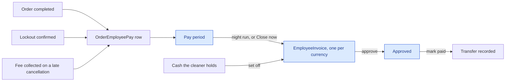

# Pay, periods, invoices and payouts

What a cleaner earns, when it is closed, which document it becomes — and where the platform stops,
because it does not move the money.

## The path

**There is no payout execution path.** The platform issues the document, an admin keys the transfer —
the invoice's `TransferAmount`, its total less the cash set off against it ([below](#cash-set-off)) — in
a bank by hand, and `MarkInvoicePaid` records that it happened, with a transfer note. Nothing here talks
to a bank, a PSP payout account or a SEPA file — which is why approval, not payment, is where the
platform does its last checking (below). That is a ruling, not a gap: payouts are manual first, then the
bank, and **never Stripe**, which takes customers' card payments and nothing else (Mike, 2026-11-08).
→ [ADR-0082](/decisions/adr-0082)

**One pay row per assigned employee, and each is one seat's share of the job** (owner rulings
2026-09-28). A rate describes the job, so `CalculateOrderPay` divides the job's base, extras and clamp
bounds by its `RequiredEmployees`, clamps the seat, and adds the dirtiness term — the job's clamped pay ×
the rate the order was booked at (`Order.DirtinessRate`), split the same way — after the clamp. Every term's cent residue goes to the first seat,
so a full crew's rows add up to the job; the divisor is the seats the job needs, not the cleaners who
came, so a cleaner who works a two-seat job alone is paid one seat. That is also why there is still no
spare seat and why the order seat needs a database-level arbiter — a cleaner on a seat the job does not
need would be paid a share on top of the whole job's pay, against an unchanged customer price.

The formula, what `extrasPay` holds (rooms, bathrooms and, since 2026-10-04, a company share of the
extras booked), why the dirtiness term sits outside the clamp, and why nothing is paid for distance
(`ExpensesPay` is 0 on every new row; older rows keep what they were
calculated with) are in [Business rules](/product/business-rules#cleaner-pay). A rate is an amount in a
currency, and the pay writer reads only rates in the order's currency — so every pay row is in the
currency of the order that earned it.

**The rates are read once, when the seat's contract for work forms** (owner ruling 2026-10-03). The
take — or the cleaner's acceptance of an administrator's placement — freezes the job's base, extras and
clamp bounds at that cleaner's rates on the seat (`OrderEmployees.JobBasePay` … `JobMaxPay`), the same
read that prices the reward the contract states, and `CalculateOrderPay` pays the seat from them. A
rate edited after the take reaches only jobs taken after it; a seat no contract has formed on yet is
paid at the rates in force when its pay is calculated.

**A job that did not happen can pay too.** Two cases, paid differently:

- **A late cancellation pays half of the fee collected** (owner ruling 2026-09-28, decision 12). When
  it brings the company a fee, `CalculateOrderPay` pays each crew member a seat's share of **half of
  what was collected** — kept from the card payment, or paid on the cash booking's receivable — and
  never of a fee still owed, nor more than the company still holds after refunds. The row is typed
  `CancellationFeeShare` (`OrderEmployeePay.LineType`; a completed job's row is `Job`), holds the share
  as an unclamped base with no rates read, and is invoiced like any other row, the invoice line saying
  it is a share of the fee. It is asked for at the cancel of an order that took a payment, and when the
  webhook settles a cash-cancellation-fee receivable; a cancelled order that collected nothing is
  refused with `payroll.no_collected_fee` and writes nothing.
  → [Business rules — the crew's share of a collected fee](/product/business-rules#fee-share)
- **A confirmed [lockout](/flows/cancellation-refund-dispute#lockout) pays each seat its full reward**
  (owner decision 2026-10-04): what the completed job would have paid it, from the figures frozen on the
  seat at the take, or at the rates in force for a seat with no contract. It is asked for at the
  confirmation, on every lockout, and paid whether or not the customer ever pays the price. The row
  keeps the type `LockoutFeeShare` and carries the job's base, extras, dirtiness and bounds, so a later
  bonus or deduction re-clamps it as on a job. Until then a lockout paid half of the fee collected, like
  a late cancellation.
  → [Business rules — a confirmed lockout pays the seat's reward](/product/business-rules#lockout-pay)

**And the order is in the cleaner's currency, because the board is.** A cleaner is paid in the currency
of the country they work in (owner ruling 2026-09-12), and `OrderVisibility.PayableTo` keeps every
order in another currency off their board, out of their counts, out of their browse and out of their
take — it answers `order.not_found`, like a held order. So under normal operation a cleaner's pay rows
are all in one currency and a period closes into one invoice. The one path the board does not decide
is an admin reassigning a cleaner onto an order: `AdminReassignOrder` does not read the currency — it
checks that the cleaner works in the order's market (`order.reassign.employee_other_market`) — which
is why the per-currency invoicing below still exists. → [Business rules](/product/business-rules#cleaner-currency)

## One invoice per employee, per period, per currency {#one-invoice-per-currency}

A pay row is in the currency of its order, and a tax document is in one unit. A cleaner who worked a
CZK job and a EUR job in the same period therefore holds pay in two units, and the close produces **one
payout invoice per currency** — each with its own allocated variable symbol — and sends **one
period-closed e-mail per document**, because the template carries a single attachment. A cleaner with no
pay in the period gets no invoice and no e-mail. The unique index is
`(EmployeeId, PayPeriodId, CurrencyId)` **and ignores cancelled invoices**, so a cancelled invoice frees
its cleaner, period and currency for the corrected invoice that follows it.

The invoice's currency is **derived from the pay rows it invoices** (`EmployeeInvoice.CreateFromOrderPays`),
never supplied — not from the employee, not from their work country, not from a preference field. That
is also why a mixed-currency period is no longer refused. The old refusal had no admin action that could
resolve it — a EUR job cannot be made a CZK job — so the rows sat un-invoiced forever while the
reconciliation sweep re-enqueued the pair every tick.

**Invoices are issued once the period has closed, never before.** `GenerateInvoice` is the one command that
issues them, for the reconciliation sweep's queue consumer and for `POST /api/AdminPayroll/generate-invoice`
alike, and it refuses an open period (`pay_period.not_closed`) before any reference is claimed. A closed
period is invoiced, and so is a paid one: a period marked paid before the sweep reached it would otherwise
keep its pay un-invoiced for good.

`GenerateInvoice` groups the employee's unassigned pay by currency, claims every payout reference
**before** staging any invoice, writes one invoice per group and flushes them together, so a period is
invoiced whole or not at all. Its already-exists guard is per currency too — a late pay row in a currency
the period has already invoiced is refused; one in a currency still open is not — and it ignores a
cancelled invoice. A dispute charge that would take the total below zero does not go on the invoice; it
waits for a later one ([below](#dispute-charge)).

After that financial commit, the shared command invokes the existing PDF generation command for each
created invoice in a fresh scope, bound to that committed invoice's tenant. A failed document commit
discards its scope before another currency is attempted; it cannot contaminate the next render or undo
financial creation. Cancellation still stops the remaining document work. This covers the manual and
queue callers. PDF generation explicitly reads the invoice's
pay period before formatting the document, and stores the file under
`{start yyyy-MM-dd}_{end yyyy-MM-dd}/{employeeId}/{invoiceNumber}.pdf`, a path that does not depend on a
language. A failed render records document failure;
it does not undo an invoice that was already created. The existing administrator regeneration action is
the recovery path if rendering fails or a process stops between the financial commit and rendering. It is
offered on `Pending`, `Approved` and `Disputed` invoices only, matching the server, which refuses a paid
or cancelled one.

**After the render, the command e-mails the invoice.** Each rendered PDF goes in a period-closed e-mail
under the night run's rules: an active cleaner whose account is active and has an address, in the cleaner's
language, one e-mail per rendered invoice, and one without an attachment when none rendered. The e-mail
writes the period and its first and last day in the recipient's language. A failed send is logged and never
fails the command. So an invoice issued after Close now, and a corrected invoice after a cancel, reaches
the cleaner.

**An action on an invoice between the night run's commit and its PDF stamp makes the stamp lose.** The
invoice carries Postgres's `xmin` as its concurrency token. An admin action committed in that gap
(`payroll.invoice.changed_concurrently` for the action that lost) leaves the invoice with no PDF address and
no PDF error flag until Regenerate PDF, and that cleaner falls back to the plain period-closed e-mail.

Document readiness is separate from invoice existence. An owned invoice with no PDF path reports that
the document is not ready, or the recorded generation failure. A stored path whose object is missing
reports an unavailable document. Foreign or nonexistent invoices retain the same not-found response.
A failed regeneration may leave the previous readable PDF in place, so its failure warning does not
remove access to that document.

**The reconciliation sweep is the one producer of invoices** (ADR-0002 D3.4, the safety net). The
`FiscalReconciliation` timer runs every five minutes and re-enqueues `generate-invoice` for every **closed**
period whose close is older than 15 minutes (`FiscalReconciliation:ThresholdMinutes`) and that still holds
un-invoiced pay, so the invoices of a period appear about 15 to 20 minutes after it closes, whether the night
run or an administrator's Close now closed it. An open period is never a candidate. The sweep matches pay
rows against **uncancelled** invoices on `(PayPeriodId, EmployeeId, CurrencyId)`, so a pair whose CZK pay is
invoiced and whose EUR pay is not is still a candidate, and so is a pair whose invoice was cancelled: its
pay rows go free at the cancel, the next run picks the pair up, and the corrected invoice gets a new number
and a new variable symbol. The message key stays per pair — `invoice:{payPeriodId}:{employeeId}` — and one
generation invoices every currency the pair still has open.

**The night-run switch does not stop it.** `PayPeriodClosing:Enabled` stops only the 02:00 run that closes
periods. The five-minute sweep keeps invoicing a period that is already closed, and a period an
administrator ends with Close now is invoiced whatever the switch says.
→ [Infrastructure — scheduled jobs](/architecture/infrastructure)

## Cash a cleaner holds is set off against the invoice {#cash-set-off}

A cleaner who took cash at the door holds the company's money, and the company owes them their pay, so
the platform nets the two instead of moving both (owner ruling 2026-09-28, decision 23 (c)). The cash
ledger — collections up; remittances, write-offs and set-offs down — is described in
[Business rules — the company's cash in a cleaner's hands](/product/business-rules#cash-held).

- **At every invoice.** The pay-period close and `GenerateInvoice` each read the cash the cleaner holds
  in the invoice's currency **under a lock on that cleaner's cash in that currency**
  (`ICashLedgerRepository.GetHeldUnderLockAsync`, a Postgres advisory lock held until the flush
  commits — the same one a remittance and a write-off take), and set it off **up to the invoice's
  total**: `EmployeeInvoice.CashSetOffAmount`, and a *Set-off* ledger entry dated at issue.
- **The invoice's amounts do not change.** `SubTotal`, bonus, deduction and `TotalAmount` stay what the
  pay rows make them; **`TransferAmount = TotalAmount − CashSetOffAmount`** is the bank transfer.
  `EmployeeInvoiceDto` and `EmployeeInvoiceDetailDto` carry `cashSetOffAmount` and `transferAmount` on
  every host.
- **The PDF says so.** A payout invoice with a set-off prints a statement below its summary — the
  invoice total, the cash set off, the transfer, and that the invoice amount is unchanged and cash still
  held is carried forward — in the **cleaner's** language (en, cs, sk, uk, ru), while the invoice itself
  stays in its jurisdiction's; a re-render reads the same language.
- **What the invoice could not cover is carried forward** — it stays in the ledger, and after
  `cash.remittance_request_days` (30 by default) past the first close that carried it, the cleaner is
  e-mailed a request to hand it over.
- **Given back when the invoice shrinks.** Cancelling an invoice enters its whole set-off back, since a
  cancelled invoice transfers nothing, and unassigns its pay rows (`OrderEmployeePay.UnassignFromInvoice`),
  so the corrected invoice holds the same jobs and sets the cash off again; lowering an invoice's total below its set-off
  (`UpdateInvoiceAmounts`) releases the difference and enters it back, so `TransferAmount` never goes
  negative and the cleaner's balance, the remittance request, the float cap and the archive all read
  the cash the cleaner really holds.
- **The archive carries it.** The company bundle writes `books/cash-ledger-entries.jsonl` (without the
  notes, which are free text) and the invoice row's `cashSetOffAmount`.

The partner web, Android and iOS show *cash I hold* per currency beside the pay (with the company's
float cap, and whether cash jobs are hidden above it), and the subtitle says the cash is set off when the
next invoice is issued. **Every invoice screen shows the set-off and the transfer.** The admin invoice list
has Cash Set Off and To Transfer columns, and the admin detail's statement ends with the total, the cash set
off (as a minus) and the amount to transfer. The partner web's list has Cash Set Off and Bank Transfer to You
columns, and its detail, like the Android and iOS details, adds *Cash set off* as a minus and *Bank transfer
to you* in bold under the total when cash was set off; with none, it ends at the total. A cancelled
invoice's detail no longer lists the jobs it held, since they move to the corrected invoice.

## Periods are a state machine, and every transition is gated {#periods}

| Transition | Requires |
|---|---|
| Close now | period is `Open`, and its start is on or before today |
| Change end date | period is `Open`; the start is unchanged; the end is from tomorrow to the period's last allowed day |
| Mark paid | period is `Closed`, every pay row in it is invoiced (`pay_period.has_uninvoiced_pay`) and every invoice in it is `Paid` or `Cancelled` (`pay_period.has_unpaid_invoices`) |
| Delete | period is `Open` |
| Create | no period is open (`company.has_open_pay_period`) and the start is not after today (`validation.invalid_date`) |

**A closed period is never reopened.** There is no Reopen and no Open: invoices are issued once a period
closes, so reopening one could only strand pay again, and a mistaken close loses nothing, because its jobs
are invoiced sooner. A paid period is the boundary after which the numbers stop moving. There is only ever
one open period per company, held by a unique index, and pay joins it whatever its dates. The one open period
that can start in the future is the one Close now opens for tomorrow.
→ [ADR-0082](/decisions/adr-0082)

**A period lasts at most its configured length**, 14 days in production (owner decision 2026-10-04; a
calendar month until then) and 3 on DEV (owner ruling 2026-11-09), from the setting
`PayPeriodClosing:LengthInDays` (`PayPeriod.CreateBiWeekly`: the end is the start plus the length minus one).
Every path that creates a period reads it: the bootstrap, the night run's successor, Close now's successor and
Create, which takes a start only. Change end date's last day is the start plus the length minus one. The
invoice is still due 14 days after issue on every stage, and the cash remittance request and the period-end
reminders keep their own clocks. → [Business rules — pay periods](/product/business-rules#pay-periods)

**The night run closes a period the night after its end date.** `CloseExpiredPayPeriods` (02:00 UTC, company
by company) closes every open period that has ended and opens the next from the day after it ended. **The
close and the successor commit first.** Only then does the run invoice each cleaner who has pay in the period
and e-mail the PDF, so every invoice and e-mail sees the period `Closed`, a crash in the middle leaves it
`Closed` with an un-invoiced tail that the sweep invoices about 15 minutes later, and no e-mail is repeated.
A cleaner the run skips (no active user or no e-mail address) is invoiced by the sweep the same way. When pay
is calculated and no period is open, one is opened from today, or from the day after the latest period's end
if that is later, so it never overlaps a period that already ran.

**Close now is the exception** (owner ruling 2026-11-08). An administrator ends the open period today with a
required reason, and the next period opens tomorrow. Jobs finished after it go into that next period. **Change
end date** moves the open period's end earlier or later, never past its last allowed day, and records the old
and new end in the audit log. → [Admin — pay periods](/admin-app/pay-periods)

Each employee's invoice work uses fresh dependencies under the period's operator, receiving only its
ID, dates, close instant and the start and end dates. Invoice, reference, cash-setoff and document commits
see the period already `Closed`. A failed employee scope is disposed before a plain-email fallback starts in a
clean scope. A failed successor or read step ends the tick, with the period already closed. These writes
record what is due; they do not transfer a payout.

**The period-end reminder** goes 3 days and 1 day before the end, and only to a cleaner who has a job or a
fee-share pay row in the period; a carried dispute charge alone does not count.

## Approval is the last point the platform can refuse {#approval-is-the-last-refusal}

An invoice is generated `Pending`, approved by an admin, and marked paid once the transfer has been
keyed (it can also be disputed or cancelled along the way; nothing writes `Rejected` any more, and the value
stays in the enum for rows written before). The two transitions on the money path are gated:

| Transition | Requires |
|---|---|
| Approve | invoice is `Pending` **or `Disputed`**, **the cleaner has a usable payout record**, **and that account holds the invoice's currency** — in that order |
| Mark paid | invoice is `Approved`. `Paid` is terminal — a second mark is refused rather than overwriting the first actor's record of a transfer that already left the bank |

**The presence rule** reads the `EmployeePayoutDetails` record itself: it must exist, `Scheme` must be
set and `Status` must be `Provided`, else `payroll.invoice.payout_details_missing`. This is ADR-0034
D7's issuance block, and it sits here rather than at generation where the ADR first put it — the ADR
carries a dated correction banner saying so. Generation would withhold a numbered tax document the
cleaner needs for their own filing, for a pay period or more; approval withholds only the admin's
commitment to transfer, the document is issued on time, and when the cleaner supplies their details the
admin approves the invoice that already exists. In the shipped tree the three conditions collapse to one,
because the only writer (`UpdateBankDetails`) always stores a scheme and `Provided`; the other two are
checked so the enum cannot quietly grow a state that passes. How a cleaner with pay rows and no record
comes about is narrow — an admin reassignment onto an incomplete cleaner, or GDPR erasure deleting the
record while pay survives — but it is exactly the case where a transfer would be keyed to nowhere.

**The currency rule** runs only once presence has passed (the chain is `Cascade.Stop`, so a missing
record is reported as missing, never as a currency mismatch). It reads `EmployeePayoutDetails
.CurrencyId` — the currency the cleaner declared their account holds — and takes an undeclared account
to hold the currency of the country the cleaner works in (CZ is CZK, SK is EUR, PL is PLN; owner ruling
2026-09-12), resolved through the same work-country chain every partner screen uses and never the
platform default. A mismatch is refused as `payroll.invoice.payout_currency_mismatch`; the cleaner
corrects the declaration (or the account) and the admin approves again. That chain has no fallback for
a named country: a work country the seed left without a real currency makes the approval throw rather
than compare against the platform default — a configuration defect surfaces here as loudly as it does
on the cleaner's own screens. → [Business rules](/product/business-rules#cleaner-currency)

**What the admin invoice page offers.** Approve on `Pending` and `Disputed` invoices (an approval keeps the
note written through Adjust or Dispute when it carries none), Cancel on `Pending`, `Approved` and `Disputed`
invoices, and Regenerate PDF on `Pending`, `Approved` and `Disputed` invoices. **Adjust Amounts**
(`UpdateInvoiceAmounts`) works only on `Pending` and `Disputed` invoices (`payroll.invoice.invalid_status`
otherwise, `payroll.invoice.already_paid` for a paid one) and renders the PDF again once the new amounts are
saved. A disputed invoice is therefore approved after it is adjusted, which a dispute used to make a dead
end. **Cancel** says that a corrected invoice with a new number follows within minutes, rebuilt from the
order payments, so a bonus or deduction set with Adjust must be set again on it, and that an invoice whose
transfer has already been sent is marked paid instead of cancelled.

**Mark paid** opens an in-page confirm on the admin web. It shows the amount to transfer, the variable symbol,
the constant symbol (`CountryInvoiceConfig.ConstantSymbol` of the cleaner's address country; `0308` for CZ)
and the partner's masked account, with a field for the bank transfer note, and sends nothing until its button
is pressed. The invoice detail carries the same constant symbol the PDF prints.

Why here and not earlier or later: generation is too early — it would withhold a numbered tax document
that already carries an allocated payout reference — and Mark paid is too late, because the money has
left. Approval is the admin's commitment to transfer, the transfer is keyed by hand, and so this is the
last moment the platform is still in the loop. The record itself is described in
[Role — EmployeePayoutDetails](/domain/roles/employee-payout-details).

## My Pay shows one currency

My Pay opens on the open period, and on the newest period only when none is open. Its period picker and its
summary name each period by its first and last day in the partner's language, and name them again on a
language switch. Within the view currency, `GetPeriodPays` links the **uncancelled** invoice, so after a
cancel and a reissue it opens the corrected invoice; a cancelled invoice is linked only while its currency
holds no other invoice, the minutes between the cancel and the reissue.

The cleaner's period view (`GetPeriodPays`) is denominated in a single currency, and everything on it —
totals and rows — is filtered to that currency. The query takes an optional `currencyId`, the **view**:
when a client names one, that is the currency shown, exactly — a client that opened My Pay from a EUR
invoice must get EUR back, not a fallback to another currency's document, which was the mislabel this
parameter closes. With no view named, the cleaner's resolved currency (the work country's configured
currency — the one the partner dashboard labels with; the platform default only for a cleaner with no
work country) is shown when the period holds an invoice in it or no
invoice at all; when the period is invoiced only in another currency, that invoice's own currency wins,
because the payout document is what the cleaner holds and "My Pay" disagreeing with it was the earlier
defect. Every pay row on the response carries `currencyCode`, and it always equals the summary's. An
unknown `currencyId` is `currency.not_found`. Because the board keeps a cleaner in one currency, a
period with pay in two is reachable only through an admin reassignment; a client that shows one invoice
at a time and passes its currency sees each of them correctly.

So that a client can pass it, `EmployeeInvoiceDto` and `EmployeeInvoiceDetailDto` carry `currencyId`
right after `currencyCode` on every host. Opened from an invoice, My Pay is that invoice's currency view:
both partner apps' invoice detail (Android and iOS) hand `invoice.currencyId` to the period-pay
route, which sends it as `GetPeriodPays`' `currencyId`. The code alone was not enough — the view is keyed by id, and
a client that only had the code would have had to look the id up or fall back to the resolved-currency
rule, which is the mislabel the parameter exists to close.

**The switch comes from the period's pay rows, not its invoices** (owner ruling 2026-09-19: the
switch should exist *"for any period holding pays in more than one currency"*). The summary carries
`availableCurrencies` — the view currency first, then every other distinct currency among the
cleaner's pay rows in that period, ordered by code — computed from the rows the handler had already
loaded before it filtered to the view, so it costs no extra query. The partner web shows the currency
switch when there is more than one entry and makes one call per period load; until 2026-09-19 it
derived the switch from the period's invoices, which meant an open (uninvoiced) period with CZK and EUR
pay showed no switch and the EUR rows were unreachable, while a **cancelled** invoice's currency was
offered with no live pay row in it. A pay row is the fact; an invoice is a document over rows, absent
on an open period and present-but-cancelled after a cancel. The view is always first so the switch
always contains the value it shows — a deep link naming a currency the period has no rows in (`EUR`
against CZK-only rows) answers `[EUR, CZK]` with an empty row list rather than a select with no
selected option. The member is additive and nullable; the mobile apps ignore it until a mobile ticket
reads it.

**The dirtiness term is its own figure.** Each pay row carries `dirtinessPay` beside `basePay` and
`extrasPay`, and the period summary totals it as `totalDirtinessPay`, in the view's currency like every
other total. The partner web's period view and its invoice lines, and My Pay on Android and iOS, show it
in the pay breakdown — the partner web only when it is not zero. The company archive's pay row keeps it
beside the other terms, so an archived row on an *Increased* or *Heavy* job reproduces its `TotalPay`
from its own columns.

**What the board promised is one seat.** The pay a cleaner sees before taking a job — the board card,
the job detail, the dashboard estimate and the available-jobs preview — is `OrderPayEstimator`'s
per-seat figure, raised by the level, the same share `CalculateOrderPay` writes for every seat but the
first (which also takes the residue cents). The partner web labels it *per spot*. Once the cleaner
holds the seat, the job detail, *My jobs* and the dashboard quote that seat's contract reward from its
frozen figures, which is what the pay row will say; the board stays at today's rates. **The estimate
before the take includes the extras share** (since 2026-10-04): `OrderPayEstimator.Estimate` adds the
company's `pay.extras_share_percent` of the extras booked, so the board, the job detail, the dashboard
and the preview quote what the contract read before the take states. Until then it passed none, and a
job with extras was quoted low until it was taken.

## A dispute charge on an invoiced job goes on the next invoice {#dispute-charge}

A charge an administrator sets on a job whose pay is already on an invoice never rewrites that invoice. It
adds a line of its own, `PayLineType.DisputeCharge`, in the company's open period, linked to the dispute with
the reason the cleaner reads, and the cleaner's next invoice deducts it. At most one such line exists for an
order and a cleaner (a second unique index). Both invoice writers, the night run with the wind-down, and
`GenerateInvoice`, take whole charges oldest first, each one that still fits, so an invoice never goes below
zero; a charge that does not fit moves to the open period and waits for a later invoice. A cleaner whose only
rows in a closing period are waiting charges gets no period-closed e-mail. The invoice PDF leaves the charge
line out of its job lines and shows it in the deduction.

## Numbering is allocated, never derived

Both the invoice number and the payout variable symbol come from an atomic `ON CONFLICT` counter, and
both carry a unique index. A number is **claimed**, not computed from a row count — a count is not
unique under concurrency, and a duplicate variable symbol is a payment that reconciles against the
wrong invoice.

> The counter is **per company and per year**: its key is `(TenantId, Year, Scope)`, since each operating
> company numbers its own payout invoices (owner ruling 2026-09-15, [ADR-0061](/decisions/adr-0061)). A
> company's first invoice of the year is `INV-2026-000001` whatever another company has issued.
> → [Business rules — each operating company numbers its own payout invoices](/product/business-rules#payout-numbering)

## Payout details never ride an employee DTO

Three routes, three shapes, and a frozen surface test that they are the only DTOs in the feature
allowed to carry a payout identifier:

| Route | Carries |
|---|---|
| the cleaner's own | full identifiers |
| admin list/detail | a masked account only — **there is no unmasked field on the record at all** |
| admin reveal | full identifiers |

**The invoice PDF is a fourth route, and it is accepted.** The payout invoice's supplier block is the cleaner,
so the PDF prints their full account, and an administrator who may download it (Accountant and above) reads
that account without the audited reveal. [ADR-0034](/decisions/adr-0034) D6 accepted this on purpose: the
account is the payment instruction the transfer is keyed from. Restricting or auditing those downloads is a
decision nobody has taken.

The reveal is a **command rather than a query**, precisely so the existing audit engine records it. The
audit trail is the compensating control for storing this in plaintext.

The declared account currency (`CurrencyId`) is not an identifier: it rides the cleaner's own view, the
admin's masked view and the GDPR export, and the reveal does not carry it because the masked view
already does.

## Edge cases

| Case | What happens |
|---|---|
| Close a period twice | Refused — it is no longer `Open`. |
| Reopen a closed period | Not possible: there is no Reopen. A mistaken close loses nothing, because its jobs are invoiced sooner. |
| Request an invoice for an open period | Refused — `pay_period.not_closed`, before any reference is claimed. |
| Create a period while one is open, or one that starts after today | Refused — `company.has_open_pay_period`, `validation.invalid_date`. |
| Change end date to today or earlier, or past the last allowed day | Refused — `pay_period.end_too_soon` (which points to Close now), `pay_period.invalid_duration`. |
| Mark a period paid with un-invoiced pay, or with an invoice still unpaid | Refused — `pay_period.has_uninvoiced_pay`, `pay_period.has_unpaid_invoices`. |
| A pay calculation the validator rejects | Logged at Error with the order, the employee and the reason key, and the message is acked; a pay row that already exists is a redelivery, logged at Information. |
| A EUR order on a CZ cleaner's board | It is not on their board: not listed, not counted, not browsable, and a take answers `order.not_found`. Only an admin reassignment can put them on it. |
| Pay in two currencies in one period (after an admin reassignment) | Two invoices, two references, two e-mails; the reconciliation sweep re-enqueues a pair while any of its currencies is still un-invoiced. |
| Approve an invoice in a currency the payout account does not hold | Refused — `payroll.invoice.payout_currency_mismatch`. The cleaner updates the declaration, the admin approves again. |
| A cleaner who never declared an account currency | Treated as holding their work country's currency at approval — the normal case; a declaration is only for an account that holds something else. |
| Two invoices allocate a number at once | The `ON CONFLICT` counter serialises them; the unique index is the backstop. |
| A cleaner with no payout destination | Blocked by the profile-completeness gate before they can work. |
| A cleaner with pay rows but no payout record | The invoice is generated and the cleaner gets their document; approval is refused as `payroll.invoice.payout_details_missing` until a record with a scheme and `Provided` exists. Reached by admin reassignment onto an incomplete cleaner or by erasure deleting the record. |
| A cleaner with a legacy `IBAN` but no payout record | Passes the completeness gate (it reads `HasPayoutDetails`, or a non-empty `IBAN` that is not the anonymisation marker), and their invoice is refused at approval by the presence rule above — the `IBAN` mirror is not a record. |
| An anonymised cleaner | Has no payout destination: erasure clears `HasPayoutDetails` and overwrites `IBAN` with the marker, and the gate does not read the marker as a destination — so an erased cleaner is incomplete, not complete-by-accident. |
| My Pay opened from a EUR invoice | A client that passes the invoice's `currencyId` gets the EUR view exactly, whatever the cleaner's resolved currency; one that passes nothing gets the fallback rule above. |
| An open period with CZK and EUR pay rows | The summary lists both; the partner web shows the switch before any invoice exists. |
| A period whose only second currency is a cancelled invoice's | Not offered — the switch follows pay rows, and a cancelled invoice has no live row in that currency. |
| Bonus or deduction applied later | Re-clamps the same core identically, because the clamp bounds are persisted on the row, and adds the dirtiness term back outside the clamp. |
| A two-seat job | Each cleaner's row is half the job's base, extras and bounds, clamped, plus half the job's dirtiness term; the first seat also takes the residue cents, so the two rows add up to the job. |
| A two-seat job worked by one cleaner | That cleaner is paid one seat — the divisor is the seats the job needs — plus the residue, since they hold the lowest seat on the crew. |
| A *Heavy* job whose rates hit their maximum | The seat is capped, then the dirtiness term (30 % of the job's capped pay, split per seat) is added on top; the cap never swallows it. |
| A dispute finds the cleaner at fault | The administrator's resolution may charge that cleaner's pay row on the order (`chargeToCleaner`): the deduction is linked to the dispute (`DeductionDisputeId`) and carries a reason (`DeductionReason`) that My Pay on the partner web, Android and iOS shows beside the deduction. On a job not yet invoiced it is a deduction on the row. On a job already invoiced it becomes a dispute-charge line on the cleaner's next invoice ([below](#dispute-charge)). Refused when the row is missing, already charged, smaller than the charge, or, for an invoiced job, when no period is open to carry the charge. A refund alone never touches pay. → [Business rules](/product/business-rules#dispute-cleaner-charge) |
| A cleaner holds 1 200 in cash and their invoice totals 900 | 900 is set off, the transfer is 0, the invoice total stays 900, and 300 is carried forward in the ledger. |
| A cleaner holds 300 in cash and their invoice totals 900 | 300 is set off and the transfer is 600. |
| A remittance and an invoice's set-off take the same cash at once | The per-cleaner, per-currency lock serialises them; the second reads the balance the first left and is refused, or sets off only what is left. |
| An invoice that set cash off is cancelled | The whole set-off goes back into the ledger, the invoice's pay rows go free, and a corrected invoice with a new number sets the cash off again within minutes. |
| Pay arrives after its period was invoiced | It goes into the next open period and is invoiced with it. |
| The night run's switch is off | Periods are not closed at 02:00, but a closed period is still invoiced by the five-minute sweep, and Close now still closes and invoices. |
| A late cancellation of a paid card order | Each crew member gets a `CancellationFeeShare` row: a seat's share of half the fee the company still holds. |
| A lockout confirmed on a cash booking whose receivable is still open | Each seat is paid its full reward at the confirmation; whether the receivable is later paid or written off changes nothing for the crew. |
| A lockout confirmed on a card order already refunded | Each seat is still paid its full reward; no collected fee is read. |
| A job with one extra booked at 250, at the default share | 125 is added to the job's extras, frozen at the take and split across the seats: 62.50 each on a two-seat job, before the dirtiness level raises it. |
| A company sets `pay.extras_share_percent` to 0 | Extras pay nothing on jobs taken after the change; a seat already taken keeps the share frozen at its take. |
| An administrator writes a cleaner's rates from a template | Standard 0.5, experienced 0.6 or expert 0.7 of each list price — every template leaves a margin, and like every rate it describes the job, so each seat of a two-seat job earns half; the old junior/medior/senior ranks are refused. → [Business rules — per-employee rates](/product/business-rules#per-employee-rates) |
| A rate is changed or deleted while a cleaner holds a job | The held job is paid at the figures frozen on the seat when its contract formed; only jobs taken after the change use the new rate. A deleted rate does not block the held job's pay. |
